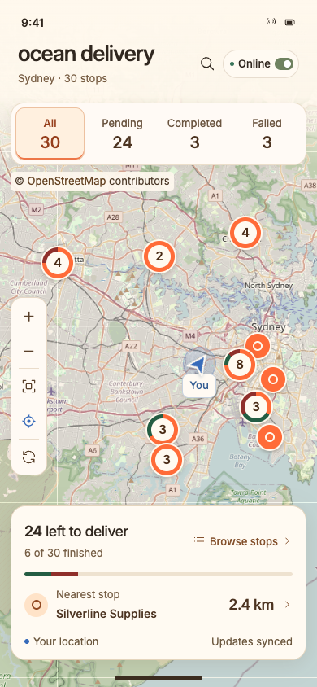

# ocean delivery

地图为基础的司机配送 App，包含交互原型和 Flutter 客户端。使用题目附件中的 30 个悉尼站点，让司机从位置与状态找到任务，完成配送或记录失败，并在离线时保留更新。



## Flutter 客户端

正式客户端位于 [app/](app/README.md)，已实现地图、列表、最近站点、按来源返回、完成/失败、直接同步反馈，以及 SQLite/outbox 和地图视口的持久保存。`local-client` 保留本机待发结果并明确提示服务不可用；`demo` 使用独立数据库和模拟确认。

从仓库根目录执行质量验证和本地模拟器构建：

```sh
python3 harness/run.py quality --isolated
python3 harness/run.py build --configuration demo --isolated
```

完整原生验收和实际中断恢复通过 [Harness 入口](harness/README.md) 执行，当前结果见 [迭代报告](harness/reports/iteration-2026-10-11.md)。虚拟机、本地构建、真实服务和生产发布分别判定。

## 浏览器原型

仓库根目录执行：

```sh
python3 prototype/serve.py
```

打开 [地图原型](http://127.0.0.1:8764/index.html) 或 [设计前后对比](http://127.0.0.1:8764/style-explorer.html)。Python 3 标准库即可启动；页面运行依赖、字体和图标均在仓库内。OpenStreetMap 底图需要联网，加载失败时仍可浏览站点和保存配送结果。

## 已实现的原型流程

- 30 个站点按附件坐标落点，密集位置聚合；Pending / Completed / Failed 同时由颜色和符号区分。
- 地图筛选、搜索、站点列表联动。列表按固定当前位置的直线距离排序；底部显示最近匹配站点及距离。
- 当前位置使用蓝色方向箭头。位置和朝向保存在 `prototype/assets/map-config.json`，原型暂时固定。
- 完成或失败即时更新站点；失败必须提供原因，Other 必须有非空说明；终态不可再次改动。
- 配送结果和未确认更新保存到 localStorage。离线可操作，重连自动同步；左侧更新按钮直接执行，并用 Toast 提示进度和结果。
- Stop list → 详情 → Stop list，恢复原列表位置；底部最近站点 / 地图站标 → 详情 → 地图。
- 鲜橙与奶油白的工具风界面、390 × 844 手机画布、用户选定的第一版 App 图标。

## 制作方式

设计使用 **Oil UI** 工作流，保留设计比较、修改说明、截图与动效证据；**Codex** 完成交互原型与验证，内置图像生成工具制作 App 图标。界面采用 HTML / CSS / JavaScript 与 Alpine.js；地图使用 Leaflet、Leaflet.markercluster 和 OpenStreetMap；Inter 字体和 Carbon 图标缓存到本地。Python 标准库负责从原始 CSV 生成页面和启动预览服务。

[原型运行与验收说明](prototype/README.md) · [当前返回规则](prototype/origin-return-design.md) · [同步及最近站点设计](prototype/direct-sync-design.md) · [第三方资源和许可](prototype/assets/THIRD_PARTY.md)

最新交互验收为 78 项连续三轮通过，报告与录屏位于 `prototype/evidence/origin-return/`。前几轮设计及证据留在 `prototype/archive/` 和 `prototype/evidence/`，用于追溯比较。

## 范围

原型和 Flutter demo 都使用模拟确认，没有真实服务端上传；距离为固定参考位置的直线距离，未接入 GPS / 罗盘、路网导航或 ETA。Flutter 实现与分层验收按 [任务图](harness/project/backlog.json) 记录，真机性能、真实服务、商业资源许可和签名发布仍需对应证据。原始题目和数据保存在 `docs/assignment/`。

## Agent 工程团队

[工程执行入口](harness/README.md) 提供需求提取、提 Issue、开发、测试、原生验收、Flutter 性能与交付的职能分工，以及总控/Harness skill、任务依赖和关闭标准。[Harness 审计](harness/reports/readiness.md) 记录实际可执行能力及尚缺的生产门槛；本地试跑与生产发布分别判定。

## 客户端架构方案

[Ocean Delivery 客户端 MVP 架构设计技术报告](docs/solution-design.md) 定义商业产品初始客户端的范围、Flutter 分层与选型取舍、本地可靠性、地图授权、性能和冷启动缓存，以及后端、用户系统、路径规划与 AI Agent 的分阶段接入。报告用于指导后续开发；移动端构建、联调和真机验收在对应实施阶段完成。
