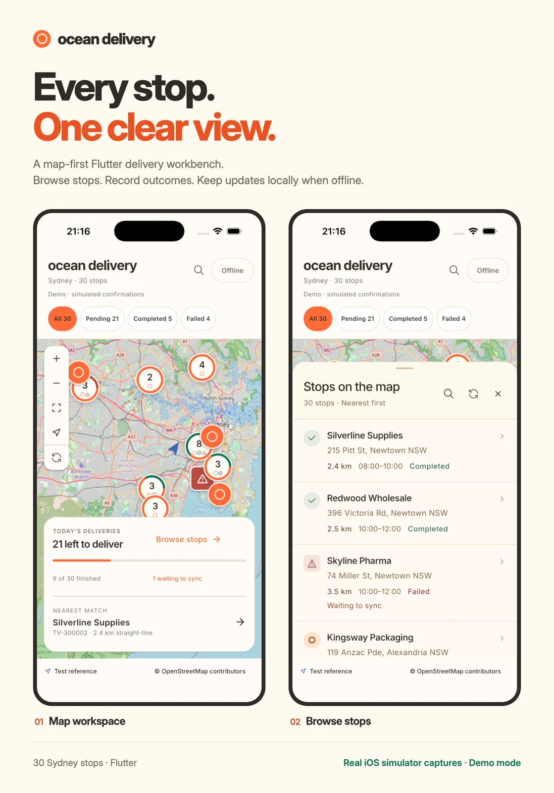
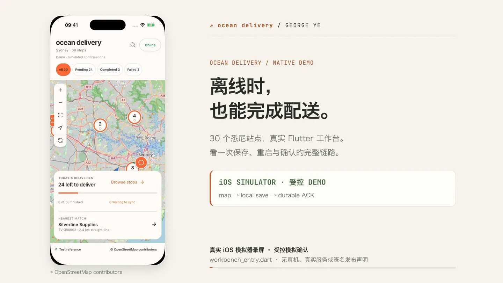
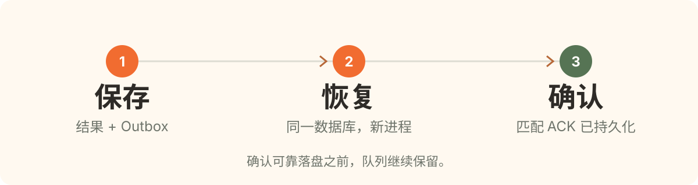
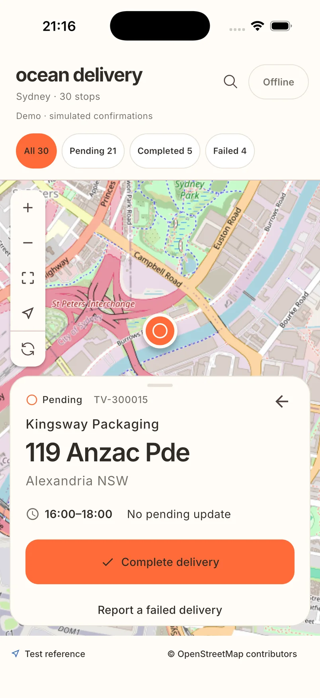
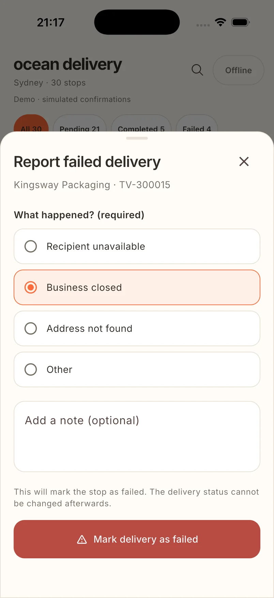
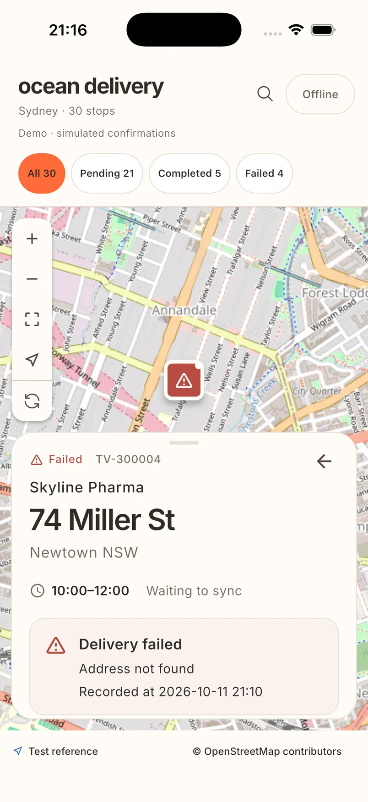
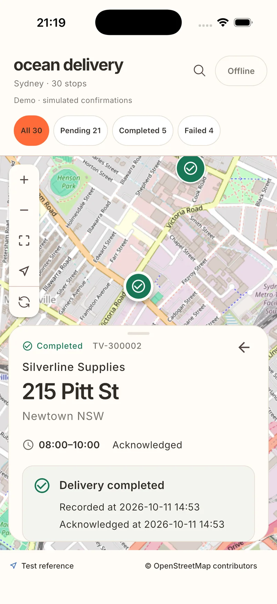

<p align="center"><a href="README.md">English</a> · <b>简体中文</b></p>

<h1 align="center">Ocean Delivery</h1>
<p align="center"><b>看清每一站，离线也能继续工作。</b><br>Know every stop. Keep delivering offline.</p>
<p align="center">Flutter · SQLite · 事务型 Outbox · iOS 模拟器 Demo</p>

以地图为入口的配送工作台：浏览悉尼周边 30 个合成演示站点，离线记录配送完成或失败，并在应用重启后恢复工作。Demo 使用**模拟确认**，尚未连接真实后端。

<p align="center">
  <a href="https://kurogeo.github.io/transvirtual-driver-delivery/#demo"><b>▶ 看 82 秒演示</b></a> &nbsp; · &nbsp;
  <a href="https://kurogeo.github.io/transvirtual-driver-delivery/">中文汇报</a> &nbsp; · &nbsp;
  <a href="https://github.com/KuroGeo/transvirtual-driver-delivery/releases/tag/v0.1.0-report.3">下载报告与视频</a> &nbsp; · &nbsp;
  <a href="#运行-demo">自己运行</a>
</p>

<p align="center"><a href="docs/report/media/showcase.webp"></a></p>

封面使用正式 Flutter Demo 在 **iPhone 17 Pro / iOS 26.4 模拟器**中的真实系统截图；拍摄时有 1 条更新等待同步。图片为压缩 WebP，原始 PNG 和可编辑排版源文件保留。[截图来源](assets/readme/capture-manifest.json) · [素材目录](assets/readme/README.md)。

## 82 秒，看完整链路

<p align="center"><a href="https://kurogeo.github.io/transvirtual-driver-delivery/#demo"></a></p>

**离线保存 2 条 → 系统进程重启 → 恢复 2 条待同步更新 → 模拟确认 → 再次启动，队列仍为 0。**

视频使用历史原生工作台测试入口、当时的数据快照及受控 HTTP 模拟确认。界面操作通过 Flutter Driver，文字输入为 driver 模拟；当前公开 App 已改用自造的合成 CSV。视频是追加演示，不代表新的完整原生验收。配中文步骤字幕，无配音，方便现场讲解。[录制证据](docs/report/media/demo-proof.json) · [讲解文字](docs/report/media/demo-transcript.md)。

**已压缩：**[MP4 · 2.80 MB](https://github.com/KuroGeo/transvirtual-driver-delivery/releases/download/v0.1.0-report.3/ocean-delivery-demo-82s.mp4) · [双语离线报告 + 视频 ZIP](https://github.com/KuroGeo/transvirtual-driver-delivery/releases/download/v0.1.0-report.3/ocean-delivery-bilingual-report-20261012.zip)。

## 离线工作为什么不会丢

<p align="center"></p>

1. **保存。** 配送结果与 Outbox 快照在同一 SQLite 事务提交；写入失败时整笔回滚。
2. **恢复。** 同一数据库在新 OS 进程中重新打开，恢复结果、原因、离线开关及队列操作身份。
3. **确认。** 串行同步只接受操作、数据集和站点身份都匹配的确认；记录确认与删除 Outbox 在同一事务完成。

<details>
<summary><b>技术选择、备选方案与运行配置</b></summary>

采用 **UI / data 两层、MVVM、构造注入和 Repository**。View 渲染界面，ViewModel 管交互，Repository 管配送一致性，Transport 管传输。跨模块编排复杂后再引入 use case。

| 选择 | 为什么采用 | 代价与调整时机 |
| --- | --- | --- |
| **SQLite / sqflite** | 结果与 Outbox 原子写入，约束和迁移明确。 | 手写 SQL 与映射；类型化、响应式查询值得引入生成工具时再考虑 Drift。 |
| **事务型 Outbox + 串行同步** | 操作身份稳定，跨进程恢复；确认落盘后才出队。 | 增加表与事务，吞吐串行；批量同步需先定义后端合同。 |
| **ChangeNotifier / Listenable** | SDK 原生状态与构造注入适合一个工作台。 | 手动管理订阅、释放和异步所有权；复杂度增长时再评估 Riverpod/Cubit，当前没有这类迁移。 |
| **flutter_map + 聚合标记** | 自定义标记支持搜索、状态与无障碍语义。 | 密集标记性能和地图许可需单独验收；瓦片缓存不等于完整离线地图。 |
| **类型化面板 + 来源返回** | 列表进入详情后回列表，地图或最近任务进入后回地图。 | 需要明确的返回测试；出现登录、深链和独立页面后再引入声明式路由。 |

只允许 `pending → completed` 或 `pending → failed`。两个结果都是终态，由 Repository 和条件 SQL 共同约束。失败必须填写原因；CSV 已有失败记录的历史原因未知，不补写虚构值。

`OCEAN_MODE=demo` 使用 `ocean_delivery-demo.sqlite` 和模拟确认。默认 `local-client` 模式使用独立数据库及 `UnavailableTransport`，保留待同步队列并提示服务不可用。重试复用原 `operationId / datasetId / stopId`；确认写入失败时保留队列，真实后端幂等仍需要服务端合同。

[完整架构与备选方案](docs/solution-design.md) · [SQLite Repository](app/lib/data/delivery/sqlite_delivery_repository.dart) · [SyncCoordinator](app/lib/data/delivery/sync_coordinator.dart)。

</details>

## 运行 Demo

**已验证目标：**Apple Silicon macOS · iPhone 17 Pro · iOS 26.4 模拟器 · Flutter **3.44.2 / Dart 3.12.2**。iOS 工程使用 Swift Package Manager；Android 已有工程骨架，但不是本次已验证交付平台。

确保终端 PATH 包含 Flutter、Python 3 和 Xcode 的 `xcrun`，从仓库根目录执行：

```sh
flutter --version
xcrun simctl list runtimes
OCEAN_DEMO_DEVICE=$(xcrun simctl create 'Ocean Delivery Interview' \
  com.apple.CoreSimulator.SimDeviceType.iPhone-17-Pro \
  com.apple.CoreSimulator.SimRuntime.iOS-26-4)
xcrun simctl boot "$OCEAN_DEMO_DEVICE"
xcrun simctl bootstatus "$OCEAN_DEMO_DEVICE" -b
python3 harness/run.py pub
cd app
flutter run --target lib/main.dart --device-id "$OCEAN_DEMO_DEVICE" \
  --dart-define=OCEAN_MODE=demo
```

自行打开 Simulator，并选择 **Ocean Delivery Interview**。命令会创建专用设备、保留设备数据；缺少 iOS 26.4 时先在 Xcode 安装该 runtime。公共 OpenStreetMap 瓦片需要联网；底图失败时仍可浏览列表、保存本地更新。

[面试预发布](https://github.com/KuroGeo/transvirtual-driver-delivery/releases/tag/v0.1.0-interview.1) 提供 **arm64 iOS 模拟器 debug Demo** 和安装说明。它不是 iPhone IPA，也没有生产签名；上面的源码命令是正式开发入口。

<details>
<summary><b>备用现场演示与真实进程重启</b></summary>

| 时间 | 操作 | 应观察到的结果 |
| --- | --- | --- |
| 0:00–1:00 | 浏览地图、列表和状态筛选，切换 Offline。 | 全新数据为 24 待配送 / 3 完成 / 3 失败。 |
| 1:00–2:00 | 完成一条待配送，再将另一条标记失败并填写原因。 | 待同步数增加 2；选择 Other 时必须输入非空文字。 |
| 2:00–3:00 | 同设备退出并重启已安装 App。 | 结果、原因、离线开关和队列恢复。 |
| 3:00–4:00 | 切换 Online。 | Demo 串行发送，匹配确认落盘后才移除队列项。 |
| 4:00–5:00 | 再次重启并解释一致性。 | 已确认操作保持确认且不重发。 |

在第二个终端填入 `simctl create` 输出的设备 ID：

```sh
OCEAN_DEMO_DEVICE='paste-the-created-device-UDID-here'
xcrun simctl terminate "$OCEAN_DEMO_DEVICE" dev.oceandelivery.oceanDelivery
xcrun simctl launch "$OCEAN_DEMO_DEVICE" dev.oceandelivery.oceanDelivery
```

Hot reload 和 hot restart 不能证明系统进程重启后的持久性。保留同一安装与数据库；可重复执行的 N1 driver 和受控 HTTP fixture 见 [app/README.md](app/README.md)。

</details>

## 测试与证据

从仓库根目录执行：

```sh
python3 harness/run.py quality --isolated
python3 harness/run.py test --target test/data/sqlite_delivery_repository_test.dart --isolated
python3 harness/run.py test --target test/sync/sync_coordinator_test.dart --isolated
```

SQLite 测试覆盖终态拒绝、必填原因、事务回滚和真实数据库重开；同步测试覆盖串行发送、身份匹配、确认写入失败和重复触发。quality 还检查依赖锁、格式、静态分析、架构与需求规则，以及全部 host/widget 测试。

已记录的应用代码基线为 **196 项 Flutter 测试 + 166 项 Harness 测试**：Darwin 上 Harness 165 项通过、1 项 Linux 专属 N/A；Linux CI 166 项全部通过。PR37 的定向 N7 验收覆盖 iPhone 17 Pro、iPhone 16 两档最大系统字号及一个普通字号配置。历史全量 34 项验收属于较早候选。[证据与限制](harness/reports/large-text-repair.md) · [原始证据索引](harness/reports/large-text-final-evidence-index.json)。

`bebda78` main 快照的 [CI 已通过](https://github.com/KuroGeo/transvirtual-driver-delivery/actions/runs/38148283089)。报告与 README 改动单独验证，不扩大原生验收范围。

## 我如何使用 AI

**AI 生成实现，我负责方向和验收判断。** Codex 生成 Flutter、原型、测试、Harness 和文档，并协调历史工程职能；Oil UI 支持原型设计，内置图像生成工具制作图标。我选择地图优先方案与图标、纠正交互、检查模拟器体验并设定交付边界，不把生成代码宣称为手写。

两次具体纠偏体现这个边界：最大系统字号实测暴露内容裁切，PR37 改为可展开摘要和完整安全区工作区，保留普通字号布局、焦点和返回来源；PR34 审查发现不完整测试日志与子进程清理可被错误接受，以严格完成检查和反例回归修复。

[第三部分：AI 做了什么、我判断了什么](https://kurogeo.github.io/transvirtual-driver-delivery/#journey) · [AI 使用与具体失误](docs/report/ai-usage.md)。

**工时说明：**仓库历史跨 2026 年 10 月 10–11 日，包含超出题目切片的原型、架构、Harness 和无障碍修复。没有可靠的人工活跃工时记录；会话及提交时间顺序不能证明全部工作符合题目 4–6 小时要求。

## 后续会做什么

- 面试追加需求保持小范围：先补一条规则或回归，再复验持久化与同步链路。
- 扩展到数千站点前，测量查询与索引、可见标记和列表成本；仅对已测出的 CPU 重任务使用 isolate。
- 接入真实配送结果前，定义后端幂等、冲突及账号归属。
- 照片、签名文件独立存储，队列记录元数据；定义续传、大小限制和孤立文件清理。
- 在真机 profile/release 测量启动、帧耗时、内存及电量。
- 评估获许可的离线地图、真实 GPS 与道路导航；当前使用固定参考点的直线距离。

**当前是面试 Demo / 预发布，生产仍为 no-go。** 真机性能（[#31](https://github.com/KuroGeo/transvirtual-driver-delivery/issues/31)）、远端强制发布检查（[#32](https://github.com/KuroGeo/transvirtual-driver-delivery/issues/32)）、真实服务与资源/签名/交付（[#33](https://github.com/KuroGeo/transvirtual-driver-delivery/issues/33)）各自待补。身份认证、推送与路线优化不在本次切片内。

<details>
<summary><b>更多真实 Flutter 界面</b></summary>

| 配送详情 | 必填失败原因 |
| :---: | :---: |
|  |  |
| **离线失败记录** | **完成记录** |
|  |  |

这些是历史模拟器实拍，保留了 Demo 标识和地图署名，没有用替换后的合成数据重新拍摄。[原图与可编辑素材](assets/readme/README.md)。

</details>

<details>
<summary><b>原型、架构与工程工作流</b></summary>

运行 `python3 prototype/serve.py` 后打开[地图原型](http://127.0.0.1:8764/index.html)或[设计对比](http://127.0.0.1:8764/style-explorer.html)。原型使用 HTML/CSS/JavaScript、Alpine.js、Leaflet 与 localStorage；历史 78 项检查通过三轮，只证明网页原型。

[Flutter 运行与测试](app/README.md) · [报告与视频](docs/report/README.md) · [合成数据](app/assets/deliveries.csv) · [来源返回](prototype/origin-return-design.md) · [直接同步](prototype/direct-sync-design.md) · [架构](docs/solution-design.md) · [Harness](harness/README.md) · [Issue 依赖图](harness/project/backlog.json) · [执行板](harness/project/work.json)。

</details>

<details>
<summary><b>公开演示数据与历史截图</b></summary>

公开 CSV 使用虚构客户、地址和生成的坐标，保留七列格式、配送编号与初始状态数量。已有安装保留自己的数据库。招聘邮件、原题附件及包含副本的工程归档保存在本地，并由 Git 忽略。历史截图与证据仍绑定各自候选。

</details>
