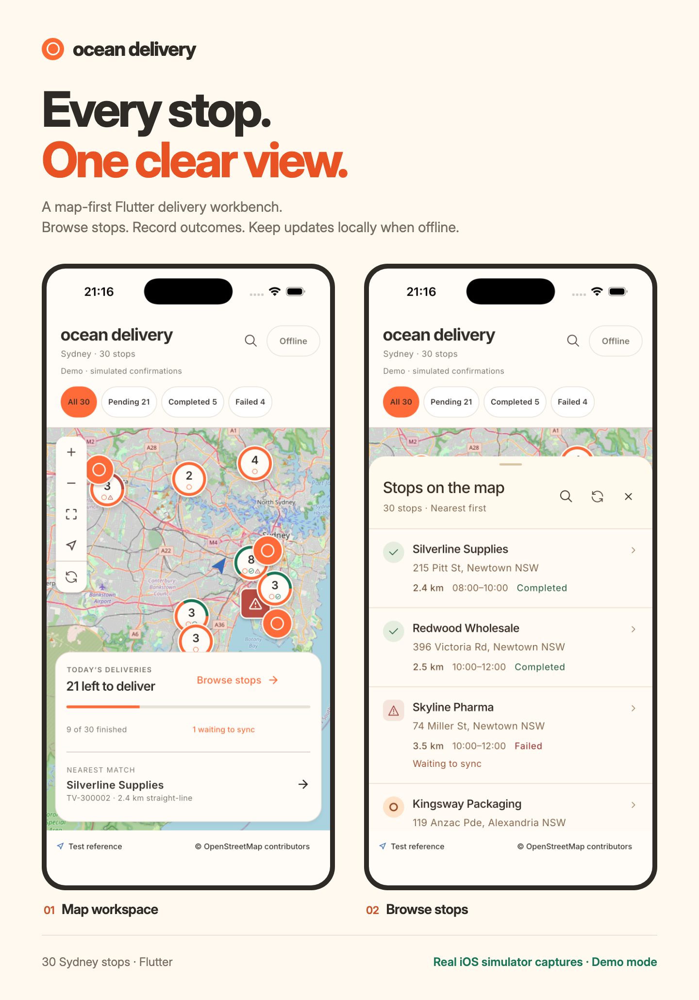

# README 展示素材

Ocean Delivery 当前 README 使用的宣传素材。所有屏幕均为正式 Flutter Demo 在 **Ocean Delivery Preview / iPhone 17 Pro / iOS 26.4** 中的真实系统截图，系统字号为正常 `large`；没有生成或重绘界面内容。

## 展示文件

- [showcase.png](showcase.png)：地图与列表的首页宣传图。
- [hero.svg](hero.svg)：可单独使用的轻量矢量标题。
- [source/showcase.html](source/showcase.html)：可编辑的封面排版源文件；引用原始截图和仓库中的 Inter 字体。
- [source/render-showcase.cjs](source/render-showcase.cjs)：后台渲染封面并检查桌面/手机宽度的脚本。
- [screenshots/](screenshots/)：六张未经修改的完整系统截图。
- [capture-manifest.json](capture-manifest.json)：截图版本、环境、尺寸、采集时间及 SHA256。

主分支源码为 `76a46307850b59113e64708a2bc272c401987120`，正式 Demo 应用源码与已验收的字体修复一致。画面中的配送客户和地址来自项目演示数据。截图时共有 30 条配送、21 Pending / 5 Completed / 4 Failed，另有 1 条已有更新等待同步；没有为了拍图新增、清除或同步业务结果。

## 宣传文案

**Every stop. One clear view.**

A map-first Flutter delivery workbench. Browse nearby stops, check addresses and time windows, and record delivery outcomes. Updates stay on the device when offline, with a visible queue for later confirmation.

**看清每一站，离线也能继续工作。**

以地图为入口的 Flutter 配送工作台：从位置与状态找到任务，查看地址和时间窗，记录完成或失败原因。离线更新保存在本机，待确认状态随时可见。

## 在当前 README 中使用

根目录 [README](../../README.md) 已嵌入 `assets/readme/showcase.png`，并附上四张可展开的详情截图。下面是封面的完整预览：



需要更轻量的标题时可改用 `assets/readme/hero.svg`。保留旁边的文字介绍和单图链接，让手机阅读及图片加载失败时仍能理解产品。

## 截图目录

| 截图 | 展示内容 |
| --- | --- |
| [地图总览](screenshots/map-overview.png) | 全部站点、状态聚合、今日余量及已有待同步更新 |
| [站点列表](screenshots/stop-list.png) | 客户、地址、时间窗、直线距离与真实状态 |
| [配送详情](screenshots/delivery-detail.png) | 地址、配送时间及完成/失败入口 |
| [失败表单](screenshots/failure-form.png) | 原因选择和可选备注；此表单未提交 |
| [失败记录](screenshots/failure-record.png) | 已有的 Address not found 原因、记录时间和待同步状态 |
| [完成记录](screenshots/completed-record.png) | 已有完成结果、记录时间和 Demo 模拟确认时间 |

截图中的 `Demo · simulated confirmations` 和地图署名均保留。Demo 确认不代表真实服务端上传；直线距离基于固定测试参考点。该素材用于呈现模拟器中的客户端功能。

## 重新制作

使用 `xcrun simctl io <device-udid> screenshot <absolute-output.png>` 采集真实画面。封面使用奶油白 `#fff9f0`、深灰 `#2e2b27`、橙色 `#ff6a32` 和绿色 `#177657`；排版沿用应用的 Inter 字体和状态点位元素。

Node 工具环境中需要 Playwright（含 Chromium）和 marked。执行：

```sh
node assets/readme/source/render-showcase.cjs
```

模块位于独立工具目录时，用 `README_PLAYWRIGHT_MODULE` 和 `README_MARKED_MODULE` 指定已安装模块路径。脚本启动临时本地服务器，在后台生成 `showcase.png` 和 900/360px 阅读预览，并检查图片加载与页面宽度；结束时关闭浏览器和服务器。也可直接打开 `source/showcase.html` 调整文字与排版。

原始屏幕保持完整，不移除 Demo 标识或地图署名。
