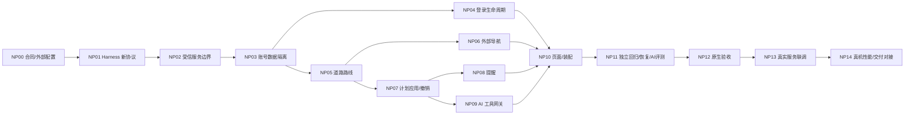

# Ocean Delivery 下一阶段方案：账号、导航与 AI 助手

状态：方案与任务准备，2026-10-12；产品实现尚未开始。来源是用户已确认的 [交互原型](../prototype/next-phase/README.md)，现有 [架构](solution-design.md) 与当前源码基线 `e8276b4`。用户授权发布带 Harness 的父子 issue，不构成部署或发布授权。可执行任务包见 [next-phase](../harness/project/next-phase/README.md)。

每项需求的原型与技术方案分别在 [路径规划与导航](next-phase/routing.md)、[登录与用户系统](next-phase/identity.md)、[AI 助手与智能派送](next-phase/assistant.md)。本总方案只记录跨需求合同；单项 issue 必须绑定对应需求材料，不能仅引用本总方案代替。

## 产品行为与默认选择

沿用推荐的 A 地图首页：地图、当前下一站、时间窗提醒和导航入口共存，助手按需打开。用户确认了原型整体，未单独指定 A/B/C。用户登录解释为司机通过企业已有身份系统登录；首版使用受信公司配置与 OIDC，公司内部非 OIDC 系统通过服务端身份桥接。自助注册、任意身份服务器地址和完整管理员门户不在本轮。

站点详情进入道路路线预览，显示来源、计算时间、道路距离和 ETA；用户选择外部导航应用。返回后恢复原站点与来源，用户手动确认到站/配送结果。打开导航、推测到站或 AI 提醒均不能自动完成配送。

AI 提供下一站、时效风险和派送顺序建议。提醒与约束计算由确定性代码执行，模型负责理解问题和解释已验证结果。规划先展示原方案/建议方案与原因，人工应用，可在版本未变化时撤销。首版没有持续后台定位、后台自动派送决策和自动修改配送结果。

## 当前基础与增量边界

现有 Flutter 使用 View/ViewModel、Repository、SQLite/outbox、串行 SyncCoordinator；当前 Transport 只有 demo/unavailable。SQLite v2 与 PendingUpdate/Ack 尚无企业/司机身份维度；查询层按固定参考点 Haversine 排序。必须先增加受信账号作用域和独立计划站序，不能把旧数据库默认归属新登录用户，也不能把直线距离作为道路 ETA。

继续复用 `flutter_map` 与现有 Flutter/Harness，不引入另一套客户端状态框架或 Runner。域模型保持纯 Dart；I/O 放 data，系统登录回调、安全存储、定位、通知和外部应用交接放 platform，启动装配仍由一个负责人维护。后端优先扩展企业已有配送服务；若没有合适服务，采用同一协议的轻量 gateway。NP00 必须确定服务实现仓库、运行环境与负责人，缺少这些输入时服务实施任务不能进入 ready。

| 边界 | 建议接口/职责 | 所有者任务 |
| --- | --- | --- |
| 共享域协议 | AccountScope、Session、RouteRequest/Result、PlanSnapshot/Proposal、Reminder、AssistantReply | NP00 冻结；实现写入者 NP03（账号）/NP05（路线）/NP07（计划）/NP08（提醒）/NP09（助手） |
| 服务授权 | 身份验证、workspace/driver 映射、派送数据权限、ACK 合同、配额 | NP02 |
| 账号容器 | 按作用域业务库、迁移、会话 generation、Transport 与同步生命周期 | NP03 |
| 登录与系统能力 | OIDC 系统浏览器、凭据、安全回调；定位/外部地图；通知 | NP04 / NP06 / NP08 各自独占对应 platform 子目录 |
| 装配与页面 | main/runtime、pubspec/lock、平台工程配置、导航、主题、主页/列表/详情集成 | NP10；消费者先提交依赖/配置需求 |
| Harness 与 CI | 契约/fixture/观察/证据门禁；回归/原生/真实服务签字 | NP01 → NP11 → NP12 → NP13 → NP14 串行交接 |

## 账号与同步一致性

`AccountScope = (workspaceId, principalId)` 使用服务端验证的内部标识；服务端以受信 issuer 与 subject 映射身份，不以邮箱或 UI 输入决定归属。客户端配置只允许已注册公司/issuer/audience/redirect；ID token 不能当配送 API 的授权依据。原生登录走系统浏览器与 Authorization Code + PKCE，校验 state/nonce/issuer/audience/回调并限制一次消费；不在 WebView 中收企业密码，不把 client secret 放 App。参考 [RFC 8252](https://www.rfc-editor.org/rfc/rfc8252) 与 [OAuth 安全最佳实践 RFC 9700](https://www.rfc-editor.org/rfc/rfc9700)。

服务端 session 返回受信 scope、权限、expiry 与服务配置版本。所有数据、路线、规划、AI 工具与 ACK 都校验 scope/dataset。服务端需持久去重 operationId，验证终态转换，并在持久接受后返回完整匹配确认；客户端匹配 scope、dataset、operationId、stopId 后事务落盘才移出 outbox。迟到/重复确认保持幂等，错账号确认拒收。

每 scope 一个业务容器/数据库及计划、提醒设置；token 放系统安全存储，业务数据不能混入 token。登录状态分为 signedOut、authenticating、active、refreshing、reauthRequired、switching。换账号、退出、授权失效与重登重置均递增 sessionGeneration，取消旧请求、停用旧 ViewModel/工具，等待或隔离旧容器在途提交后关闭。新账号 token 不得授权其他 scope 队列；原账号重新认证后可恢复其原队列；旧 ACK 只允许按原凭据和 scope 收尾原库；旧查询、路线、模型与 refresh 不能更新新 UI、凭据或恢复旧会话。

过期暂停联网同步，保留原账号本地结果与 operationId；原账号重新验证后恢复。离线可读/可写期限与撤权策略由企业配置冻结；超出离线授权范围锁住相应业务操作，但不删除已持久结果。refresh 为单一在途操作，按 IdP 的旋转或 sender constraint 合同处理重放防护；退出后的迟到刷新不能恢复会话。退出立即清凭据并锁住业务视图，保留原账号待同步数据，界面明确保留数量；切换账号创建另一个容器。需清除本地数据时必须有单独显式用户动作，不能把退出当删除。SQLite v2 旧库先保留为 legacy/demo 隔离区，仅在服务端验证 dataset 归属后迁移到对应 scope；无法证明归属时禁止自动绑定。迁移事务失败回滚，保留可重试旧库与待同步记录。

## 路线与外部导航

`RouteRequest` 包含 scope、dataset、stopId、起终点、出发时间、定位时间/精度、出行模式、请求 ID 与输入版本。`RouteResult` 包含 provider/configRevision、computedAt/expiresAt/departureAt、距离米、时长秒、几何、定位来源、durationBasis（staticRoad 或 trafficAware）和降级原因。静态路网耗时必须注明不含实时交通；计算时间新鲜不代表交通数据实时。采用道路提供商明确允许的 OSM-compatible 路由与地图组合；NP00 冻结供应商、覆盖范围、许可/缓存策略、超时与配额。可以评估自托管 OSRM 的 route/table 能力，但公开 demo 不成为生产依赖；[OSRM API](https://project-osrm.org/docs/v5.24.0/api/) 定义道路 route/table 数据。服务不可用不伪造 ETA。

现有 OSM 地图版权继续显示；公共瓦片没有离线批量下载能力或生产 SLA，按 [OSM 瓦片政策](https://operations.osmfoundation.org/policies/tiles/) 选择商业/自托管资源。Google Routes 若作为备选，需要单独的地图/归属设计；其政策要求在 Google 地图上展示叠图结果，且限制缓存，不可直接把 Google 路线叠在现有 OSM 地图上，见 [Google Routes 政策](https://developers.google.com/maps/documentation/routes/policies)。

仅在请求与当前 scope/stop/inputRevision 匹配时展示结果；拒绝旧坐标/低精度，支持权限拒绝后手动选择可信起点并明确来源。离线可展示政策允许的缓存路线及其时间，过期数据不可称为实时；没有数据时显示 unavailable，重试带取消与有界退避。

导航选择器优先系统支持的地图 App，使用合法编码的白名单目的地/模式；[Google Maps URLs](https://developers.google.com/maps/documentation/urls/guide) 与 [Apple Map Links](https://developer.apple.com/documentation/mapkit/unified-map-urls) 作为外部交接协议。打开成功只表示 handoff，导航可能进入预览/浏览器；定位、导航启动与到站分开记录。未安装/打开失败提供地址复制或另一应用，返回保存 origin/stopId/query/viewport。首版到站由司机确认，后续若增加地理围栏须另建定位与电量验收范围。

## 派送计划与提醒

`PlanSnapshot` 保存 scope/dataset、planId/revision、仅 pending 的站序、服务日期、IANA 时区、每站时间窗/服务时长与来源。原 CSV timeWindow 字符串不能直接承担真实调度；无法解析/缺失窗口要显式标记 unknown，不能编造截止时间。用业务时区解析窗口，用可注入时钟和定位来源计算风险，跨午夜与 DST 单测覆盖。

单独维护 activeStopOrder/nextStop；列表计划顺序与地图编号一致，最近距离继续标为直线距离。优化器使用道路矩阵、时间窗、停留时间和固定/已完成站约束，先构造可行解，再做有界优化；30 站作为现有工作负载，扩大容量须重新冻结预算。模型不创造路线数值。状态区分可行、部分不可达、搜索预算耗尽与已证明约束冲突；启发式未找到方案只能表达“本次未找到可行方案”，不能声称已证明无解或全局最优。每个可应用方案逐站验证覆盖与约束，失败不能标为已优化。

`PlanProposal` 包含 baseRevision、inputFingerprint、scope/dataset、站点集合、位置/时间版本、expiresAt、原/新指标与计算来源。应用事务再次检查完整输入：用户/批次、pending 集合、终态、当前计划、位置/时间有效性和服务配置；任一变化使提案失效。双击只应用一次；落盘失败不改 UI。Undo 只允许 proposal-applied revision 未变化且输入仍有效；发生新配送/调序时拒绝旧 Undo，改为重新计算。

调序仅改计划，不能改 Stop 终态、完成数量、失败原因或创建/清除配送 outbox。计划成功落盘后再发进度事件；重启恢复同一版本。若未来同步共享计划，用独立的幂等计划提交合同，不复用配送结果 outbox。

提醒由风险规则触发：截止风险、下一个 pending 站、路线/登录不可用。按 scope+serviceDate+stop+windowId+rule 稳定键去重与暂缓，planRevision 仅校验新鲜度；普通重算不能重复弹出或重置 snooze，设置可持久化；终态、换账号和提案过期清理对应提醒。首版优先前台提醒，授权后可用本地通知；未授权不循环申请，通知锁屏内容按隐私设置最小化，不能声称后台持续精确跟踪。恢复前台重新计算计划与通知，时区/时钟变化重算。

## AI 服务与权限

App 通过已授权的服务端助手接口访问模型，模型 secret 留服务端。工具允许 `getNextStop`、`getDeliveryRisks`、`previewPlan`，所有参数服务端按 JSON schema、范围和当前用户权限再次验证；取数据由服务端决定 scope，不接受模型传入另一个用户标识。不存在 completeDelivery/clearOutbox 工具。提案产生后仍由客户端显式应用及事务版本检查。

助手回答包含结构化事实、来源对象/版本、observedAt/computedAt、数据新鲜度、proposalId 与拒绝/降级原因。显示“数据于…更新”；没有道路来源不回答确定 ETA。本地未同步终态覆盖旧服务端 pending 来决定本机下一站；联网请求可带原 scope 的 EffectiveSnapshot（serverSnapshotVersion + localRevision + operationId/status overlay + planRevision/inputFingerprint），服务端验证 scope、可访问站点、唯一 ID、合法状态与结构，计算同一有效 pending 集，标注未确认来源；它只能用于查询/提案，不能当持久接受回执。响应回传完整输入指纹，客户端拒绝已经变化的快照。站点备注、用户文本、工具返回均作为不可信数据，不能扩充工具权限；拦截越权 stop、错误数字、未知工具、超限站数、无效 schema、迟到响应与注入诱导。函数调用也需要应用层执行和验证，参见 [OpenAI 函数调用](https://developers.openai.com/api/docs/guides/function-calling)；协议保持供应商可替换，不预先创建密钥或采购模型。

工具调用有每用户/公司配额、总时限、最大轮数、取消、请求去重、审计与敏感信息脱敏。NP00 冻结容量/延迟/成本预算；AI 不可用时司机仍能看站点、手动导航与配送。离线问题仅回答允许访问的缓存事实，不能假装调用在线模型；语音提醒是可选后续能力，首版不承诺麦克风或语音识别。

## Harness 与实施顺序

下一阶段使用 NP-R01–NP-R16 与 NP00–NP14 独立命名空间，不改写旧 R01–R17/已接受任务。此次增加的静态检查验证需求覆盖、无环依赖、共享写域、计划状态、命令分类和 issue 正文/发布身份；纳入原型源码与方案指纹。它验证任务包结构，不证明新功能已实现。新增 host/native/live 检查均 planned。

NP01 扩展现有 native 合同、fixture、可观察工具和门禁，支持新验收 ID 与服务配置指纹；当前 Runner 只有旧 N1–N7，不能用它们代签登录/导航/Agent。要求账号 A/B、超时/撤销/旧回调、在途 ACK、路线失败、错 scope、stale plan、原子应用失败、时区、重复提醒、注入和限流等确定性 fixture。独立原生进程检查需真正杀进程重开，记录数据库/站序/operationId、导航系统返回及原始 trace；真实企业 SSO、道路/模型服务与物理设备另签 NP13/NP14。

NP11 用 held-out 故障与对抗样本测“正确/拒绝/恢复”，记录逐案例判定、输入来源、模型/服务配置版本、工具参数与预算；网页、fixture、debug、模拟器和真实服务证据分别表达。运行报告沿用候选前后指纹、设备/资源租用、精确 attempt 路径、原日志 hash；旧报告只作为 historical，不复签当前候选。取消工具任务时只清理自有后代与租用，保留已落盘记录，恢复创建新 attempt。

首次产品派工前 NP00 要确认身份 issuer/client/redirect/scopes、业务授权和 ACK、供应商/缓存许可、数据时区和窗口、服务实现源、模型/隐私/配额、设备/容量/性能预算。外部值未取得则对应任务 blocked，不妨碍已准备好的合同校验与 fixture 工作。真正执行仍须另有产品实施指令。

已有 [#31 真机性能](https://github.com/KuroGeo/transvirtual-driver-delivery/issues/31)、[#32 强制发布门禁](https://github.com/KuroGeo/transvirtual-driver-delivery/issues/32)、[#33 真实资源/签名/发布](https://github.com/KuroGeo/transvirtual-driver-delivery/issues/33) 保留。NP14 提供本轮增量证据并交给这些任务；旧 issue 的通过不会自动证明新功能。生产继续 no-go，只有实际 H01–H08/G0–G6、外部资源、强制执行与交付授权全部满足才可能解锁。

NP14 对 #31/#32/#33 是非阻塞证据交接引用；它不等待发布任务完成才产生发布前证据。生产门禁仍要求这些任务实际满足。

## 审查补充合同

EffectiveSnapshot 的基线是 assignment/serverSnapshotRevision，带明确 clientReported 的 localRevision、未同步终态及 activePlanRevision。查询、提醒与优化共用该快照；远端刷新不得覆盖未确认的本地结果、失败原因、note、operationId 或 outbox。冲突显式显示并重新计算提案，事实区域仅展示来源校验后的结构化数值。

退出、授权失效、切换与开始新认证均推进 sessionGeneration；原 AccountScope 与持久 operationId 不因此改变。只有尚未超时且匹配原请求的 ACK 能在开放的隔离旧容器收尾；超时后的迟到结果不进入确认路径。旧 refresh/登录回调绝不保存新凭据或复活会话。

提醒稳定键还包含 dataset；同窗口 snooze/关闭状态跨计划重算保留，风险升级按明确规则触发。换号取消旧账号可见提醒和系统通知，保留其设置、去重和暂缓记录。路线结果包含 requestedDepartureAt/arrivalAt、durationModel/trafficAware 与可取得的 roadDataVersion，多站 ETA 含等待/服务时长；NP00 冻结定位年龄/精度与重算阈值及目标 OS 的 Apple URL/兼容方式。

B1 去重记录保留期覆盖最大允许离线期与重试周期；401 暂停待原账号重认证，403/撤权、业务冲突或永久拒绝进入需处理状态，保留结果/outbox/拒绝依据并停止自动重复发送。网络、限流和暂时服务故障按预算重试；拒绝不能生成 ACK。NP00 冻结优化能力由现有服务、外部服务或维护算法提供，不因此自动新建求解平台。
