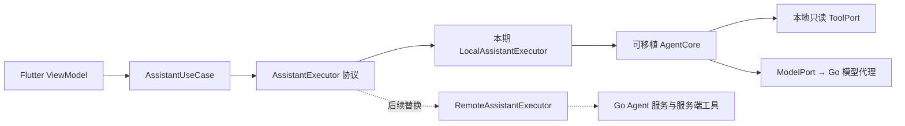

# 需求 3：AI 助手与智能派送

2026-10-12 用户修正：本期可以在客户端执行，但目标是服务端 Agent。执行位置必须可替换，不能把 Agent 循环、工具和业务逻辑写进 Flutter 页面。方案为待实施设计，原型交互沿用已确认版本。

## 原型与用户流程

[可点击原型](http://127.0.0.1:8764/next-phase/assistant.html) · [原型源码](../../prototype/next-phase/assistant.html)

1. 首页显示下一站与时间窗风险，司机可暂缓或关闭提醒。
2. 打开助手查询下一站、超时风险与派送建议，回答显示来源和更新时间。
3. 比较当前/建议站序、道路指标与理由，司机手动应用，可在版本有效时撤销。
4. 提案过期阻止应用；离线与助手失败各有明确状态，仍可普通配送与导航。

原型回复、道路数值与优化为模拟，没有调用模型、优化服务或系统通知。执行位置变化不改变这套用户流程。

## 分层与本期执行位置

| 层 | 职责 | 本期 | 后续服务端化 |
| --- | --- | --- | --- |
| View / ViewModel | 展示事实、状态与计划比较，接收用户确认 | Flutter | 保留 |
| AssistantUseCase | 取得有效快照、发起/取消请求、检查返回 scope/generation/fingerprint | 客户端应用层 | 保留 |
| AssistantExecutor | 统一执行入口与可序列化 Request / Response 合同 | LocalAssistantExecutor | 切换为 RemoteAssistantExecutor |
| AgentCore | 模型—工具循环、白名单、预算与执行状态机 | 纯 Dart，无 Flutter/SQLite/平台依赖 | 在 Go 服务实现相同协议；复用合同和案例，不要求复用 Dart 二进制 |
| ModelPort / ToolPort / Clock | 模型访问、只读查询/提案、时间与取消 | 注入本地 Repository 适配器及受信模型代理 | 服务端 Repository / 模型适配器 |
| PlanRepository / ReminderDispatcher | 人工 Apply/Undo、计划事务、设备通知与 snooze | 客户端持久化与平台适配 | 保留；服务端只生成 Proposal / ReminderIntent |

页面只能依赖 UseCase 和结构化结果，不能直接调模型、选择工具或读数据库。AgentCore 不读 Widget/BuildContext、ChangeNotifier、SQLite DAO、安全存储或通知插件；协议和工具模型为纯 Dart/JSON。NP09 提供核心和适配器，NP10 单写依赖及启动装配。本期 Go 模型代理只处理身份、模型凭据、配额与受限模型请求，不承担 Agent 循环、工具执行或站序应用。代理使用受限业务 DTO 与服务端 model/schema/token policy；按用户/受信业务 namespace 原子预留/结算预算，并发不能超支，取消后的已发生费用仍结算；未知供应商接受状态保留记录，不自动重放付费请求。客户端循环预算不能替代服务端费用边界。

## 可迁移协议

AssistantRequest v1 包含 requestId、protocolVersion、intent、用户问题、scope/sessionGeneration、dataset、EffectiveSnapshot、inputFingerprint、policyVersion、deadline 和能力列表。Snapshot 是服务端派单基线加明确 clientReported 的本地终态/operationId overlay、localRevision 与 activePlanRevision；不传 token、数据库路径或客户端闭包。身份字段用于相关性校验，未来服务端仍从已验证会话重建权限，不能相信请求里的 scope。

AssistantResponse v1 包含 requestId/runId、protocolVersion、输入指纹、结构化 facts/sourceIds/observedAt/computedAt、可选 PlanProposal/ReminderIntent、执行状态、降级/拒绝码和用量。运行状态区分 running/completed/rejected/cancelled/timedOut/failed；审计事件记录 executorKind、core/policy/model/provider 版本、tool 参数摘要与耗时。接口具体命名由 NP00 冻结；提供执行句柄与取消，UI 不依赖本地工具内部事件或供应商响应格式。

Local 与未来 Remote 使用相同 JSON schema、字段单位、错误码、版本兼容策略和合同 fixture。相同受控模型/工具输入应得到等价的业务事实、提案和拒绝结论；不比较自由文本逐字相同。Remote 的受控 adapter 可在本期用于替换测试，但不冒充真实 Go Agent 已上线。未知协议/额外字段、越权 ID、非有限数值、迟到请求和重复结果拒绝。取消、换号、sessionGeneration 变化或 fingerprint 更新后，旧结果不能进入新视图或 Apply。

## 工具、规划与提醒

工具白名单只有 getNextStop/getDeliveryRisks/previewPlan，没有 completeDelivery/clearOutbox。执行器从受信会话注入 scope，ToolPort 核验 ID/状态/版本/参数；客户端检查负责本地一致性，所有远端数据读取和模型代理仍由 Go 服务独立鉴权，不能用本地校验代替服务器权限。备注、用户问题和工具文本是不可信数据，不能扩大工具能力。模型 secret 留在 Go 模型代理；App 内没有长期模型密钥。

本期 RouteRepository 直接使用第三方道路能力，PlanningEngine 在客户端通过注入的道路矩阵、完整 pending 集、服务日期/IANA 时区、窗口、停留与固定顺序生成并验证可行提案，不新增自建算路/规划服务。矩阵不可用时明确降级；启发式/预算耗尽不证明无解或全局最优。后续规划能力通过同一 PlanningPort 迁到 Go Agent 服务。

查询、提醒与规划读取同一 EffectiveSnapshot，排除本地已完成但服务器仍 pending 的站点；overlay 只用于查询/提案，不能充当 ACK。远端刷新不覆盖未确认结果、原因、note、operationId 或 outbox。回答必须附来源、时间、新鲜度与 clientReported 未确认标识，没有道路来源不编造 ETA。

PlanProposal 绑定 scope/dataset/baseRevision/inputFingerprint/expiry/完整站点集合；人工 Apply 再校验并事务落盘，双击幂等、失败不改 UI。Undo 仅原版本与输入仍有效时允许。调序不改配送终态、统计、原因或配送 outbox；重启恢复同版计划。执行器迁移不改变 Apply 的客户端事务所有权。

ReminderPolicy 是可独立测试的确定性规则；服务端化后可返回 ReminderIntent，设备展示、权限、去重与暂缓仍由客户端处理。稳定键为 scope+dataset+serviceDate+stop+windowId+rule，planRevision 仅验新鲜度；重算和换执行器不重置 snooze。换号取消旧可见通知并保留旧账号设置。有道路 ETA 才称迟到风险，否则只提示窗口临近。首版前台提醒，不承诺持续后台定位或语音识别。

## 迁移步骤与验收

1. 本期冻结 v1 协议、工具与预算；实现 LocalAssistantExecutor、AgentCore、ToolPort/ModelPort 和模型代理。
2. 本期通过受控 Remote adapter 替换同一个 UseCase，证明页面、PlanRepository 和提醒分发无需改写；记录 local/remote-fixture，fixture 不是服务端交付。
3. 后续单独实现 Go Agent 模块、服务端工具授权、短时 clientReported overlay 核验及可取消 run；不提前把该实施任务写成已完成。
4. 通过同一合同案例、真实服务权限/成本/延迟、换号/超时与幂等验收后，按 workspace 配置切换。禁止自动从 remote 失败静默回退 local 执行；显式重试生成新 requestId，旧 run 已终止或过期才允许重做。

NP07 负责计划/Apply/Undo，NP08 提醒，NP09 本期可迁移客户端执行器与模型代理，NP10 装配，NP01 Harness 协议与观察，NP11 独立合同/替换/对抗评测，NP12 原生恢复，NP13 本期真实模型代理与道路联调，NP14 真机成本和性能。未来 Go Agent 实施另立后续任务，不作为本期关闭前置条件。

必须验证：核心无 Flutter/平台依赖；Local→受控 Remote 替换不改页面和持久化；协议 round-trip、工具 schema 与事实等价；stale/双击/落盘失败/Undo 冲突；完整唯一站点集；本地终态 overlay/outbox 不变；DST/snooze；注入/越权/超额/取消/迟到；真正杀进程恢复计划和设置。原日志必须写清执行位置与 fixture/live 边界。

模型凭据、数据地区/保留、身份权限和预算由 NP00 冻结。原型与方案先于 issue；本轮范围为设计、Harness 准备与 issue 发布，产品实现未开始。模型协议的官方背景见 [函数调用](https://developers.openai.com/api/docs/guides/function-calling)，执行循环分层为本项目设计决策。
