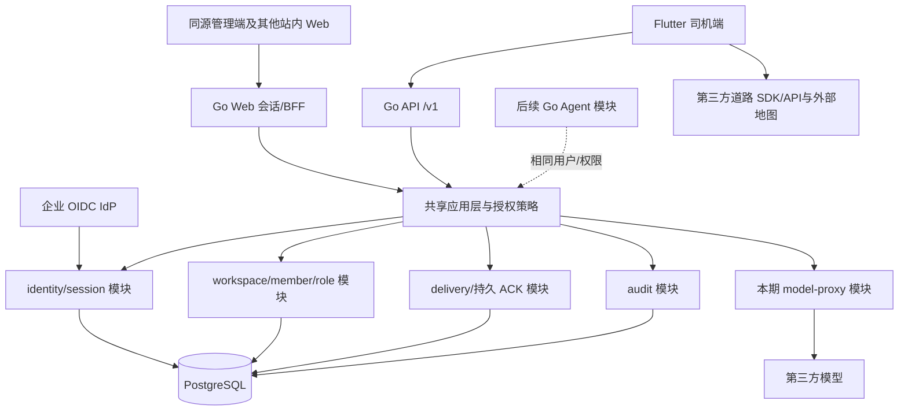

# 全站 Go 后端架构：账号、组织与权限

2026-10-12 用户指定 Go，且用户系统是全站能力。本文件是待实施架构，覆盖司机端、管理端及后续接入的站内应用；不是给 Flutter 增加一个登录接口。采用 Go 模块化单体 + PostgreSQL + REST/OpenAPI，先共用一套身份和授权，不先拆微服务。具体 Go/数据库/库版本由 NP00 在实施时核验并锁定。

## 系统边界



本期自建服务有全站身份/权限、配送数据/ACK 与保护模型密钥的轻量代理；不提供 routes/matrix API，也不自建道路服务器。Agent 循环本期在客户端，后续新增 Go assistant 模块；模型代理不是服务端 Agent。企业身份认证与本站业务授权分开：企业 IdP 判断身份，本站控制成员资格、角色、数据权限和会话。

## Go 模块与依赖方向

| 模块 | 本期职责 | 依赖 |
| --- | --- | --- |
| identity | 受信 issuer/JWKS 验证、登录事务、外部身份映射 | 配置、IdP adapter、Repository |
| session | 本站会话、移动端刷新、Web cookie、撤销与重放防护 | identity、authorization、Repository |
| workspace / membership | 组织、邀请、加入/停用/离开、成员版本 | authorization、audit、Repository |
| authorization | permission catalogue、系统角色、资源归属与默认拒绝 | 受信 Actor、membership/role Repository |
| delivery | 派单读取、终态校验、operationId 幂等持久接受与 ACK | authorization、SQL transaction、audit |
| audit | 管理变更与拒绝日志、关联 requestId、脱敏保留 | SQL transaction、受控日志 sink |
| modelproxy | 模型 secret、本站鉴权、模型白名单、限额/预算/取消 | authorization、provider adapter |
| assistant（后续） | AgentCore 对应的执行协议、工具与运行状态 | 同一 authorization、delivery、model adapter |

依赖顺序为 HTTP handler → application/use case → domain/ports → infrastructure adapter。domain 不依赖 net/http、SQL 驱动或模型 SDK；handler 不直接写数据库。跨模块通过明确接口，不相互读取私有表。初期同进程、同数据库，用事务完成需要一致性的变更；不引入消息队列或 Redis 作为身份正确性的必要条件。

规划目录：

```text
service/
  go.mod / go.sum                 # NP15 单写，版本实施前锁定
  cmd/api/                       # NP15 单写启动、shutdown、配置
  internal/platform/             # HTTP middleware、DB pool、clock、logging
  internal/identity/             # NP02
  internal/session/              # NP02
  internal/authorization/        # NP16
  internal/workspace/            # NP16
  internal/membership/           # NP16
  internal/delivery/             # NP02
  internal/audit/                # NP16
  internal/modelproxy/           # NP09；没有本期 Agent loop
  internal/assistant/            # 后续迁移，当前不创建实现
  api/openapi.yaml               # NP15 单写，消费方提交接口需求
  migrations/                    # NP15 单写，领域任务提交 migration 需求
  tests/contract/                # NP15 协议基线
  tests/identity/                 # NP02
  tests/authorization/            # NP16
  tests/modelproxy/               # NP09
```

NP00 冻结领域接口；NP15 是 Go 共享依赖/启动/OpenAPI/schema/部署与迁移的唯一集成写入者，NP02/NP16/NP09 不各自创建另一套启动或 schema。SQL 显式参数化，database/sql 事务由应用层统一界定；实现可采用合适 PostgreSQL 驱动，不预设 ORM。Go 官方 [事务说明](https://go.dev/doc/database/execute-transactions) 和 [net/http](https://pkg.go.dev/net/http) 是实现基础，模块化单体是本项目设计选择。

## 数据模型与租户隔离

| 表 | 核心字段/约束 |
| --- | --- |
| users | 全站 userId、displayName、status、version；邮箱仅属性 |
| external_identities | issuer + subject 唯一 → userId；不同 issuer 的相同邮箱不能自动合并 |
| workspaces | workspaceId、slug 唯一、status、version、policyVersion |
| memberships | workspaceId + userId 唯一，status、role、version；用户可属于多个组织 |
| permission_catalog / roles | 固定 permission code、系统角色权限集合；首版不开放任意策略脚本 |
| invitations | workspaceId、受信 issuer/目标验证条件、tokenHash、expiresAt、consumedAt、role、version |
| login_transactions | 一次性 transactionId、issuer/client/nonce、expiry、consumedAt；不保存密码 |
| sessions / refresh_tokens | userId/workspaceId、clientKind、expiry、revokedAt、family/version、opaque tokenHash |
| audit_events | actor、workspace、action、target、version、requestId、outcome、time；不记 secret |
| assignments / stops | workspaceId、assigned userId、dataset/stopId、snapshotRevision、业务状态 |
| accepted_operations | workspaceId + userId + dataset + operationId 唯一、payloadHash、结果/ACK；冲突不得确认 |

站内 AccountScope 的 principalId 映射全站 userId，workspaceId 表示本次活动组织；所有资源查询同时限制 workspaceId 与必要的 assignedUserId。请求参数中的 workspace 只是目标选择，服务端从会话和当前有效成员资格验证后创建 Actor；客户端 header/body、邮箱或 token 中未校验的角色不能决定授权。数据库加入带 workspaceId 的组合唯一键/外键，避免关联到别的租户资源。

首版每个受保护 Repository 必须要求受信 Actor/scope，并有 A/B 租户反例。若采用 PostgreSQL RLS 作为第二层防御，必须固定非 owner/无 BYPASSRLS 的应用角色、事务内 SET LOCAL scope 与 FORCE ROW LEVEL SECURITY，并测试连接池复用不串租户；不能仅开启 RLS 就声称隔离成立。官方说明 owner/特权角色有绕过边界，见 [PostgreSQL 行安全](https://www.postgresql.org/docs/current/ddl-rowsecurity.html)。迁移/维护连接不能用于普通 HTTP 请求。

## 登录、会话与跨端使用

移动端沿用系统浏览器 OIDC Code + PKCE。Go 创建一次性 loginTransaction/nonce 与受信公司配置；App 完成 IdP 授权后提交受信身份证明和 transaction。Go 验证 issuer、签名/JWKS、audience/azp、expiry/nonce、事务匹配与一次消费，映射外部身份并检查有效 membership，再发行本站会话。具体企业 IdP 支持的 token exchange/验证方式由 NP00 冻结；不能只接受 App 自报 userId/邮箱。参考 [OIDC Core](https://openid.net/specs/openid-connect-core-1_0.html) 与 [原生 OAuth RFC 8252](https://www.rfc-editor.org/rfc/rfc8252)。

管理 Web 同源由 Go BFF 完成 code exchange，使用 Secure/HttpOnly/SameSite cookie；状态变更需要 CSRF 与 Origin 校验。不把长期 token 放 localStorage，CORS 精确 allowlist，不允许 wildcard 搭配 credentials。App 使用短期 opaque bearer access token + 轮换的 refresh family；服务器只存高熵 token 的受保护 hash。具体有效期由 NP00 冻结并限制，刷新为单一在途，重放触发撤销/重新认证，不能靠永久 JWT 忽略停用。

refresh family/token 在数据库事务中行锁或 CAS，一次消费旧 token、创建下一版本并提交，最多一个并发请求成功；重放处理原子撤销 family。客户端单一在途不能替代服务器多副本原子性。刷新响应丢失时不得盲重试旧 token，按 NP00 冻结的安全幂等方案恢复，否则重新认证；不默默恢复旧 family。

登录、刷新、权限操作和模型代理都检查当前 session、user、workspace、membership 状态；禁用用户/成员或改权限推进 authorizationVersion 并撤销相关会话/缓存授权。管理变更返回成功后开始的新请求必须看到新权限；已在途写事务在提交前按同一锁/版本重新验证。旧 scope 的有效已接受 ACK 仍按原 operationId 收尾，不能污染新 scope。

企业 IdP 侧撤权只有在收到可信事件/重新验证后才能获知；没有事件时由短期重新认证和企业配置界定最大延迟，不能承诺即时全网离线撤权。离线授权期限单独控制客户端可读/可写范围，超限锁住操作但保留已保存 outbox。本站 refresh 不替代企业重新验证，不能让被 IdP 撤权身份无限续期。

API 允许当前用户列出可访问组织并显式切换，目标组织重新授权，签发绑定该组织的新会话；旧会话撤销和客户端 generation 推進，待同步数据继续归旧组织。后续其他站内应用接同一本站身份和权限接口，不复制用户库。

## 管理与权限

首版内置 owner/admin/dispatcher/driver：owner 管组织/管理员，admin 管成员与普通角色，dispatcher 管授权范围内派单，driver 只读本人派单与提交本人配送结果。permission 示例 users.read、members.invite、members.update、sessions.revoke、assignments.read/write、deliveries.submit、assistant.use、audit.read；按动作+资源判定，默认拒绝。

首个 workspace 与 owner 仅由受信平台运维操作/受控 bootstrap 事务创建并写审计，要求绑定已验证的 issuer+subject；不得把第一个登录者自动升 owner。此入口不向普通匿名请求或组织 admin 开放。

没有有效 membership 的受邀用户使用一次性 invitation/loginTransaction 流程提交受信 OIDC 身份证明，只允许接受匹配邀请，不签普通数据访问会话。事务内核验邀请/受信身份、原子消费 token、建立身份映射与 membership、写 audit；提交成功后才签发绑定 workspace 的正式会话。事务/审计失败保留未消费邀请，避免先签会话后失败；不要求先有正式 membership 会话才能加入。

邀请链接短期、一次消费，验证受信身份满足邀请条件后建立 membership；不因为邮箱相同自动连接已有全站身份。改角色/停用采用 membership version/If-Match 防止覆盖旧页面。禁止提升超过调用者可授予的权限；最后一个有效 owner 不允许被停用/降级，按 workspace 行锁/串行事务保证两名管理员并发不同时删光 owner。全站 user disable 只能平台级运维主体执行并审计，组织 admin 只能停用本组织 membership，不能停用此人在其他公司。

管理操作与 audit_events 同事务；审计落盘失败则管理变更失败，不显示成功。邀请发放返回令牌或受控链接，真实邮件发送需要独立接入及授权；此轮原型不发送邀请、不建真实账号。审计只读、分页/脱敏、限制查询范围；保留期和删除流程由 NP00 冻结。

## REST API 草案与失败语义

| 接口草案 | 行为与边界 |
| --- | --- |
| POST /v1/auth/transactions、/sessions/federated | 受信登录事务/验证身份、一次消费、建立本站会话 |
| POST /v1/sessions/refresh、/logout | 轮换/撤销；客户端清凭据但不删除业务记录 |
| GET /v1/me、/me/workspaces；POST /v1/sessions/switch-workspace | 当前用户及可访问组织，显式切换重授权 |
| GET /v1/workspaces/{id}/members、/roles | 当前组织授权后的分页成员/可授予系统角色 |
| POST /v1/workspaces/{id}/invitations；POST /v1/invitations/accept | 创建/消费一次性邀请，受限角色、幂等请求 |
| PATCH /v1/workspaces/{id}/members/{userId} | 角色/状态变更，If-Match、权限与最后 owner 保护 |
| POST /v1/workspaces/{id}/members/{userId}/revoke-sessions | 只撤销目标成员本组织会话 |
| GET /v1/workspaces/{id}/audit-events | 限租户/权限的只读审计 |
| GET /v1/assignments；POST /v1/delivery-updates | 本人/授权派单；完整 operationId 持久接受后 ACK |
| POST /v1/model/completions | 本期受限模型代理，白名单、配额与取消；不执行 Agent 工具 |
| POST /v1/assistant/runs（后续） | 后续 Go Agent 的统一执行协议，不是本期实施前置 |

Go modelproxy 接受受限业务 DTO，provider/model、工具 schema、最大输入/输出、每用户/组织配额均来自服务端 policy，不透传任意 URL/供应商原始请求。调用前按 user/workspace 原子预留预算，完成后结算，超时/取消仍按供应商已发生用量结算；并发请求不能绕过预算。供应商接受状态未知时保留预留和 unknown 记录，待核对或按保守上界结算，不自动重复付费请求。客户端的轮数/取消不能决定服务器成本；服务端只执行受限模型请求，不执行 Agent 循环。

统一 JSON 错误带 requestId/code/retryable/安全提示：401 未认证/过期，403 无权/撤权，409 版本/幂等冲突，422 无效状态/参数，429 配额并附重试依据，503 暂时服务不可用。不把拒绝写成 ACK；限制 body/分页、参数 schema、deadline。日志无 token、完整 prompt/客户备注或邀请令牌。

## 部署、可靠性与验收

一个可水平扩展 Go 服务，所有会话/幂等/审计在 PostgreSQL 持久保存；滚动重启不依赖单机内存会话。TLS 入口、环境隔离和 secret manager，启动时必需配置缺失失败；不提供默默 demo 回退。设置 HTTP header/read/write/idle timeout、请求 context deadline、数据库连接池和有界外部调用；shutdown 停接请求，限时等待/取消自有请求，不伪确认未提交操作。liveness 与 readiness 分开，数据库不可用返回未就绪。

migration 通过独立部署步骤和版本锁串行执行，不由每个副本启动时竞跑；expand/contract 支持滚动版本，破坏迁移先备份并验证恢复，生产数据回退不能靠直接降 schema。审计/幂等保留、备份/PITR、真实恢复演练与监控告警为上线证据。观测包含 requestId、模块、脱敏 actor/scope、权限拒绝、refresh replay、ACK 持久接受/重试、数据库/模型耗时与成本。

NP15 负责 Go 基础/共享 schema/OpenAPI/环境/迁移；NP02 身份/会话/派单 ACK；NP16 全站组织成员/RBAC/管理审计；NP09 模型代理；NP11 独立 Go 集成/租户/并发/恢复回归；NP13 真实企业服务，NP14 发布交接。Go 测试命令、数据库 fixture 和 HTTP/API 观察由 NP01/NP15 纳入 Harness，未实现前只能 planned。

关闭前必须覆盖：受信 bootstrap/首次无 membership 邀请激活、多副本 refresh 双请求与响应丢失、模型代理并发预算/取消后费用/未知接受状态、两个租户同 email 不合并、同用户跨组织、司机访问他人站、admin 不得跨组织停人/升 owner、两人并发移除最后 owner、邀请重放/过期、web CSRF、refresh replay/换号/迟到、停用后新请求拒绝、在途提交再校验、管理/audit 事务失败、ACK 提交后丢响应重试、Go 进程重启、数据库断连与迁移恢复。Go 单测/受控 DB、真实 IdP、原生 App、生产环境分别签，不能互相代签。
