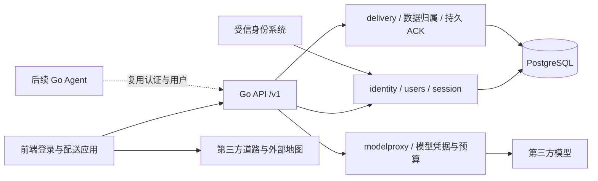

# Go 后端架构：用户表与登录认证

2026-10-12 最新范围：只做后端用户数据、登录认证和会话架构，供前端登录/退出/恢复及业务数据归属使用。用户明确取消 B 端和用户管理。本设计不包含管理页面、用户列表/管理 API、组织成员、邀请、角色配置或 RBAC 平台。采用 Go 模块化单体 + PostgreSQL + REST/OpenAPI；具体版本实施前由 NP00 核验锁定。

## 系统与模块边界



identity 负责验证受信身份；users 负责内部 userId、基础资料与状态；session 负责访问会话、刷新和退出；delivery 负责数据归属与持久 ACK；modelproxy 本期只保护模型 secret/费用，不执行 Agent 循环。用户状态用于认证有效性和系统运维，不提供用户管理功能。路线不经过自建 Go 服务。

依赖方向为 HTTP handler → application/use case → domain/ports → infrastructure adapter。domain 不依赖 net/http/SQL/模型 SDK，handler 不直接写数据库；Repository 必须接收服务端验证产生的 Actor，不能把客户端 userId 当授权依据。初期一个 Go 进程与 PostgreSQL，无必需 Redis/消息队列/微服务。后续其他用户端可复用同一身份体系，不因此增加 B 端。

```text
service/
  go.mod / go.sum                 # NP15 单写
  cmd/api/                       # NP15：配置/启动/关停
  internal/platform/             # NP15：HTTP/DB/日志/clock
  internal/identity/             # NP02：受信登录适配
  internal/users/                # NP02：用户记录和当前用户读取
  internal/session/              # NP02：会话/刷新/退出
  internal/delivery/             # NP02：业务归属与持久 ACK
  internal/modelproxy/           # NP09：受限模型代理
  internal/assistant/            # 后续迁移，本期不实现
  api/openapi.yaml               # NP15 单写，消费方提交协议需求
  migrations/                    # NP15 单写，领域任务提交 schema 需求
  tests/contract/                # NP15
  tests/identity/、tests/delivery/ # NP02
  tests/modelproxy/               # NP09
```

Go 官方 [事务说明](https://go.dev/doc/database/execute-transactions) 和 [net/http](https://pkg.go.dev/net/http) 是实现参考；模块化单体和 PostgreSQL 为项目设计选择。Go 依赖、启动、OpenAPI/schema/migration 由 NP15 单一负责人集成，NP02/NP09 不另建启动或私自迁移。

## 用户与会话表设计

| 表 | 字段与约束 |
| --- | --- |
| users | id UUID PK；display_name；email 可空；email_verified；status；auth_revision；created_at/updated_at/last_login_at；邮箱不是登录身份主键 |
| external_identities | id；user_id FK；issuer；subject；created_at/last_verified_at；UNIQUE(issuer, subject)，同邮箱不同 issuer 不自动合并 |
| login_transactions | id；受信 issuer/client/config_revision；nonce_hash；expires_at/consumed_at；一次消费；不存密码 |
| sessions | id；user_id FK；account_namespace；client_kind；access_token_hash 唯一；auth_revision；created_at/expires_at/revoked_at/last_seen_at |
| refresh_tokens | id；session_id/family_id；token_hash 唯一；generation；expires_at/consumed_at/revoked_at；刷新 family 原子轮换 |
| assignments / stops | account_namespace；assigned_user_id FK；dataset/stop_id；snapshot_revision；业务状态/时间窗 |
| accepted_operations | account_namespace + user_id + dataset + operation_id 唯一；payload_hash；accepted_at；持久 ACK 内容；同 ID 不同 payload 拒绝 |

不建 memberships/invitations/roles/permission_catalog 或管理审计表。保留必要的认证/安全事件结构化日志，但没有审计管理页面/API。

AccountScope.principalId 映射内部 userId。已有 workspaceId 仅为兼容业务协议的 account_namespace，由部署配置/受信身份与派单源映射确定，不代表组织管理实体或邀请资格。每用户只能访问其已授权派单；请求体/header 的 userId/namespace、邮箱和昵称不能决定归属。SQL 显式包含 namespace+assigned_user_id 条件，组合键/外键防跨用户引用；不做管理角色例外。

首次经验证的登录：Go 核验受信身份及本站接入条件后，在事务内根据唯一 issuer+subject 查找或创建 users/external_identities，并建立本站会话。并发首次登录靠唯一约束/事务处理得到同一 userId；不能因相同 email 合并身份。仅创建基础用户记录，不授予管理员或创建公司。是否允许可信身份首次接入、issuer 白名单与派单身份映射由 NP00 冻结；不允许任意 issuer/用户自报身份创建账号。

## 认证、会话和时间架构

沿用已确认前端原型的受信公司身份登录。Go 创建一次性 loginTransaction 与 nonce；原生端通过系统浏览器 OIDC Code+PKCE 完成认证，提交受信身份证明。Go 检查 issuer/JWKS 签名、audience/azp、expiry/nonce、事务绑定/一次消费和接入策略，再发行本站会话；App 不持 client secret 或收企业密码。具体企业 IdP 验证/token exchange 在 NP00 冻结；参考 [OIDC Core](https://openid.net/specs/openid-connect-core-1_0.html) 与 [RFC 8252](https://www.rfc-editor.org/rfc/rfc8252)。认证 ProviderPort 为可替换适配器，本期不额外引入密码注册、找回密码或管理员审批流程。

访问凭据使用短期高熵 opaque token，refresh 使用轮换 family，服务端只存受保护 hash，客户端放系统安全存储。登录/刷新/API 请求均校验 session、user 状态、auth_revision 和 namespace；用户数据读取与模型代理独立验证业务归属，默认拒绝他人资源。token 不含可由客户端扩权的角色。

所有持久时间字段使用 PostgreSQL timestamptz，服务端 UTC 为权威，API 使用含时区的 RFC3339 时间；前端按当地时区展示。Clock 可注入，NP00 冻结 access/refresh/loginTransaction TTL、允许的验证时钟偏差、IdP 再验证和离线授权期限。客户端本机时间不延长会话；请求耗时/超时使用 Go context deadline 与单调耗时，时钟前跳/后跳、过期边界均有 fixture。

refresh 在 SQL 事务内对 family/token 行锁或 CAS，一次消费旧 token并持久创建下一代，多副本最多一个并发请求成功；重放原子撤销 family。响应丢失不盲重试旧 token，按冻结的安全幂等方案恢复，否则重新认证。Go 重启后会话、轮换和撤销记录仍在数据库；不依赖单机内存。

退出撤销当前本站 session/family，前端清凭据、锁视图并推进 sessionGeneration，保留用户本地结果/outbox；旧刷新不复活会话。企业 IdP 侧撤权按可信事件或短期重新认证获知，离线授权期限单独控制读写；不能承诺即时撤销离线访问。已在途业务写在提交前验证会话/授权版本；已持久接受的合法旧 scope ACK 可收尾原隔离容器。

## 最小前端 API

| 接口草案 | 行为 |
| --- | --- |
| POST /v1/auth/transactions | 获取受信身份配置和一次性登录事务 |
| POST /v1/sessions/federated | 验证身份，创建/取得用户记录和本站会话 |
| POST /v1/sessions/refresh | 原子轮换本站会话凭据 |
| POST /v1/sessions/logout | 幂等撤销当前会话，前端保留业务记录 |
| GET /v1/me | 返回当前用户基础资料/可信数据归属；不接受查询他人的 userId |
| GET /v1/assignments；POST /v1/delivery-updates | 本人的派单读取及完整匹配持久 ACK |
| POST /v1/model/completions | 本期模型代理，服务端固定 model/schema/token policy、预算与取消 |
| POST /v1/assistant/runs（后续） | 同协议 Go Agent 执行入口，本期不实现 |

没有 /users 列表/CRUD、组织成员、邀请、角色管理、管理后台/BFF 或管理端登录接口。未来用户端 Web 若接入，应单独冻结 cookie/CSRF 或 bearer 方案，不能凭本文件宣称已交付。

统一错误为 401 过期/未认证、403 无权/撤权、409 幂等或版本冲突、422 非法参数/状态、429 限额、503 暂时不可用，带 requestId/code/retryable，日志无 token/原始身份凭据。ACK 仅在结果和去重记录原子持久接受后返回；客户端匹配落盘成功才清 outbox，拒绝和超时不得确认。

Go modelproxy 只接受受限 DTO，model/provider/schema/输入输出上限来自服务端 policy，不透传任意 URL。按 user/namespace 原子预留/结算预算，取消仍计算已发生费用；未知供应商接受状态保留预留/unknown记录，核对或按保守上界结算，不自动重放付费请求。它不执行客户端 Agent 工具循环。

## 部署、恢复与 Harness

Go 服务可水平扩展，状态持久在 PostgreSQL；配置/secret 缺失失败，不回退 demo。设置 HTTP/read/write/idle timeout、DB pool、有界外部调用、context取消、graceful shutdown、liveness/readiness及脱敏 requestId日志。迁移由独立步骤/版本锁串行执行，expand-contract兼容滚动版本，破坏迁移先备份/验证恢复，不能每副本启动竞跑。

NP15 负责 Go 基础/schema/OpenAPI/迁移，NP02 用户/认证/会话/派单 ACK，NP09 模型代理，NP11 独立 Go/DB 集成与故障测试，NP12 原生登录/退出恢复，NP13 真实 IdP/服务，NP14 真机/发布交接。用户管理 NP16 已取消；生产门槛仍保留原范围。

必须验证：首次登录并发只建一个用户、同 email 不同 issuer 不合并、伪造身份/过期/重复事务拒绝、A/B 用户数据隔离、GET /me不读他人、多副本 refresh/replay/丢响应、退出后旧刷新、时钟边界/重启、安全存储与迁移失败、ACK提交后丢响应重试、数据库断连/恢复、模型并发预算和取消成本。fixture/Go 单测、原生/真实身份服务与生产部署分别签字；本文件只交付设计。
