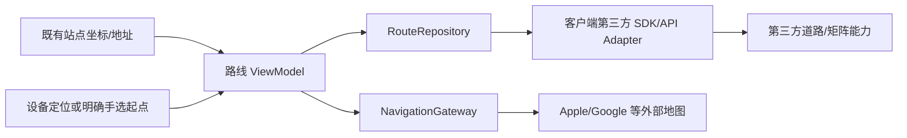

# 需求 1：路径规划与导航

2026-10-12 用户修正：尽量不牵扯自己的后端，第三方既有能力不算自建后端。本期采用客户端直接接第三方道路能力与地图导航；不新增 Go routes API、自建路线代理、OSRM 服务或导航后台任务。账号/派单仍使用全站 Go 后端，但算路链路不经过它。

## 原型与用户流程

[可点击原型](http://127.0.0.1:8764/next-phase/routing.html) · [原型源码](../../prototype/next-phase/routing.html)

1. 从站点详情取得既有目的地坐标/地址，客户端请求道路预览。
2. 有有效第三方道路结果时显示路线、距离、预计到达与来源；不可用则显示“应用内路线暂不可用”，保留打开地图导航。
3. 选择 Apple Maps/Google Maps，交给对应应用算路与导航；返回恢复原站点与入口。
4. 司机手动确认到站与配送结果，打开地图或 AI 提醒不改变配送终态。

已确认原型的预览数值/定位/交接为模拟。此次明确技术接入边界，并补充第三方预览不可用的交接降级；未取得供应商配置时不得用固定值冒充真实道路结果。

## 客户端架构

RouteRepository 依赖可替换 ThirdPartyRoutePort，不依赖本项目 Go 服务。LocationGateway/NavigationGateway 负责系统定位与外部应用。保留现有 Flutter 分层和底图，NP05 写道路 adapter，NP06 写平台交接，NP10 单写依赖/导航/平台工程配置。账号 scope 用于本地缓存和异步隔离；第三方请求仅传必要坐标/出发时间/车型，不能转发本站登录 token、司机身份、客户备注或 operationId。

NP00 选择可从移动端直接调用、支持目标地区与道路矩阵、允许目标地图展示、具备合适配额和缓存许可的第三方方案。只使用供应商明确允许分发并可作应用限制的公开客户端凭据，不在 App 中放服务 secret。如果供应商必须经过私密服务密钥或自建代理，则本期不采用；选另一客户端 SDK/API 或降级外部地图，不能偷偷增加自建路线后端。供应商/包版本实施前核验，当前不采购、不生成密钥。

第三方 SDK/API 用于应用内预览和智能规划的道路矩阵；外部 Maps URL/Intent 用于交接。URL 交接只能在外部显示路线，不能把其页面数据当成本站 RouteResult/矩阵。Google Maps URL 本身无需 API key，详见 [官方文档](https://developers.google.com/maps/documentation/urls/get-started)；Apple 交接协议见 [官方 Maps URLs](https://developer.apple.com/documentation/mapkit/unified-map-urls)。第三方云端算路和网络仍是依赖，零自建后端不表示完全离线。

RouteRequest 本地绑定 scope/dataset/stopId/inputRevision、requestId、起终点、定位时间/精度、出发时间及模式。RouteResult 带 provider/configRevision/computedAt/expiresAt/departureAt/arrivalAt、距离、几何、时长模型及 trafficAware；静态路网耗时注明不含实时交通。直线距离与 Maps URL 打开结果不能冒充道路 ETA。

现有 OSM-compatible 底图仅叠加供应商许可允许的路线。Google Routes 如选用则需要单独满足其地图/缓存政策，不默认叠加在 OSM 上；[Google Routes 政策](https://developers.google.com/maps/documentation/routes/policies)。公共 OSM 瓦片仍无生产 SLA/离线批量下载承诺，见 [OSM 瓦片政策](https://operations.osmfoundation.org/policies/tiles/)。本期不自建地图或道路服务器。

## 返回、故障与数据保护

保存 scope/dataset/stopId/origin/query/viewport，返回后核验账号和站点；区分 unavailable、launchFailed、handoffRequested、returned。打开成功不能推断已开始导航/到站，外部 App 独立算路的 ETA 可以不同。不依赖外部 App 返回算路结果。

权限拒绝/过旧定位允许司机明确选择可信起点，或把起点留给地图 App。第三方超时/不可达/限额/不支持矩阵时明确失败与有界重试；单站导航仍可交给地图。地图 App 未安装可选另一 App、浏览器地图或复制地址。缓存合法且有效才展示，过期不称实时；换号/站点/输入变化拒绝迟到结果。基础导航交接可在没有道路服务配置时验收；应用内道路预览和矩阵必须有独立真实来源证据。

## Harness 与任务

NP-R04–NP-R06 对应 NP05 客户端第三方道路 adapter、NP06 导航交接和 NP10 装配；NP07 的本期规划直接消费道路矩阵，不增加 service/routes 或 service/planning。NP01 提供 fixture/观察/门禁，NP11 独立回归，NP12 原生交接/返回，NP13 真实第三方道路与地图联调。

必须证明算路请求不命中本项目后端、无本站 token/身份泄露；无路线配置也可 Maps 交接；路线 A/B 乱序、定位降级、超时/限额/不可达/矩阵缺项、地图未安装、回原站点/换号拒绝、缓存来源和 outbox 不变。HTTP trace/SDK trace 记录第三方而非 self-hosted；网页/fixture 不代签原生/真实服务。

先准备本项原型和方案再整理 issue。第三方预览/矩阵配置未取得时只阻塞对应能力，不能阻塞基础地图导航交接。
