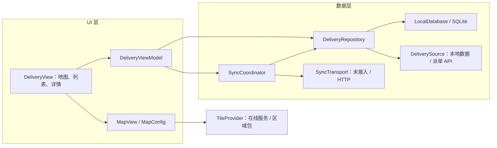
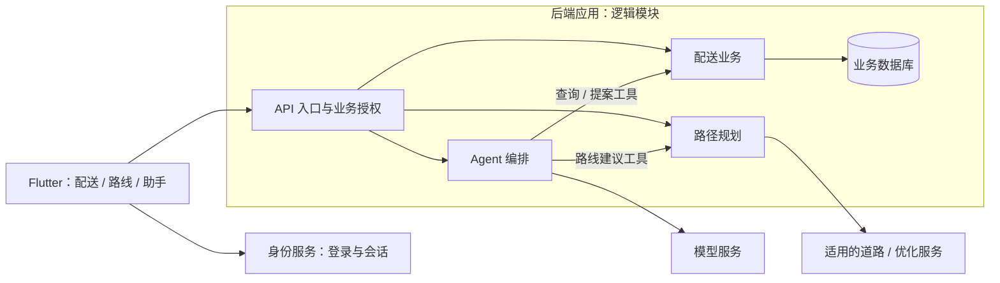

# Ocean Delivery 客户端 MVP 架构设计技术报告

设计日期：**2026-10-10**。设计范围：用于商业产品起步的 Flutter 客户端 MVP，以及后端、用户系统、路径规划和 AI Agent 的后续建设路线；后端独立开发，通过约定接口接入。

本报告面向技术负责人、客户端研发与后端协作团队，明确产品范围、技术选型及取舍、模块职责、数据可靠性、地图授权、性能设计和后续演进条件。

## 1. 项目目标与设计约束

Ocean Delivery 面向配送人员，以地图为主入口，提供站点查询、配送结果记录与待同步管理。首个客户端版本需要在弱网或无网络时完成本地业务操作，并为后续真实派单、身份认证和结果上传建立清晰的接入边界。

架构采用 **轻量 MVVM + Repository + SQLite + 小型待同步队列 + 串行同步协调**。地图使用 flutter_map，界面使用 Flutter 官方组件与品牌主题，依赖通过构造函数注入。

设计目标包括：

- **业务可靠**：提交结果后能够跨进程恢复；配送结果与待发送记录保持一致。
- **体验连贯**：地图、列表和详情联动；返回保留会话上下文；冷启动复用历史视口和本地数据。
- **性能可验证**：限制无关刷新与重复计算，在约定设备和业务容量下验证流畅性。
- **增长有边界**：业务模型独立于地图插件和传输协议，持久数据能够随版本迁移。
- **商业条件明确**：区分地图数据许可、在线服务条款和离线使用权，落实业务数据来源。

### 1.1 MVP 功能范围

| 能力 | 预期行为 |
| --- | --- |
| 地图、列表、搜索、筛选与详情 | 地图为主页；列表展示配送编号、客户、地址和状态；地图与列表使用一致的筛选结果 |
| 配送结果记录 | 待配送（pending）→ 已完成（completed）或失败（failed）；新提交的失败原因去除首尾空白后必填；终态不可重复修改 |
| 本地持久化与待同步管理 | 数据落盘后提示保存成功；结束进程后记录仍在；可查看待同步数量与具体记录 |
| 后端未接入时的运行 | 显示“已保存在设备 / 等待连接服务”，待同步记录持续保留 |
| 返回上下文 | 列表进入详情后返回原搜索、筛选和滚动位置；地图进入详情后返回地图 |
| 冷启动与底图降级 | 恢复有效历史视口；本地业务优先可操作；底图不可用时仍可使用列表、详情和结果保存 |

首个客户端 MVP 暂不包含登录、路径规划/ETA、AI Agent、照片/签名、持续后台定位、多端冲突处理、后台定时上传和多工作区切换。其中后端接入、用户系统、路径规划与 AI Agent 属于确定的后续建设方向，按第 9、10 节分阶段交付；客户端首版先完成本地业务和地图体验。

初始测试数据包含 30 个站点：24 个 pending、3 个 completed、3 个 failed。数据缺少派单日期和历史失败原因，导入时保留缺失信息。测试数据、测试确认与真实商业数据分开使用；商业使用需要取得授权业务数据。固定司机位置用于可重复测试，产品未接入真实定位时隐藏当前位置/距离，或明确标注为参考位置。

## 2. 技术选型与 trade-off

技术选型以本地业务可靠性、地图交互、维护成本和实际扩展需求为依据。

| 领域 | 选择与收益 | 代价及替代方案 | 演进条件 |
| --- | --- | --- | --- |
| 应用框架 | Flutter；统一移动端业务与主要界面实现，适合地图与列表组合交互 | 地图插件、平台生命周期和原生构建仍需分别验证；原生实现具备直接的平台能力，但需要维护多套客户端 | 特定平台能力或性能瓶颈难以通过现有实现解决时，评估局部原生能力 |
| 分层 | 轻量 MVVM + Repository；展示状态、业务规则和 I/O 职责明确 | Repository 需要保持内聚；完整 domain/use case 分层更适合复杂业务编排，也增加代码与维护成本 | 重复规则、跨模块编排或团队分工使现有职责难维护时增加领域层 |
| 状态管理与依赖注入 | ChangeNotifier/Listenable + 构造函数注入；依赖少，测试替换直接，便于局部订阅 | 订阅、dispose 与异步错误需要显式管理；Riverpod/Cubit 可提供更多状态与依赖组织能力 | 多页面共享依赖、异步组合或多人协作复杂度显著提高时评估框架 |
| 页面导航 | 单工作台采用类型化面板状态，结合 Navigator / PopScope 处理页面和系统返回；返回来源集中管理 | 面板回退需显式验证；go_router 更便于多页面、深链与路由重定向，也增加路由配置 | 登录、深链或多个独立页面形成实际需求时接入声明式路由 |
| 界面组件 | 官方 Material 组件 + 品牌主题；沿用成熟交互与可访问性能力 | 业务站标、卡片需要定制；Cupertino 或第三方组件库提供不同视觉与交互，但增加适配和版本兼容工作 | 明确的平台体验需求或组件复用收益出现时调整 |
| 本地存储 | sqflite / SQLite；支持事务、约束与可迁移数据，适合离线业务 | SQL、映射与迁移需手写；Drift 提供类型化查询和响应式能力，也引入生成链与额外学习成本 | 查询与响应式读取显著增多且团队具备维护能力时比较 Drift |
| 待同步机制 | 小型 outbox + 串行发送；结果快照与确认对象明确，恢复路径简单 | 多一张表与提交/确认事务，吞吐受单请求限制；Stop 上同步标记可进一步减少表，批量/并行可提高吞吐 | 实际队列等待影响业务时，按服务能力评估批量或并行 |
| 地图渲染 | flutter_map + 聚合；Widget 站标便于品牌、点击和可访问性定制 | 插件兼容与密集点性能需自行验证；原生地图 SDK 或矢量方案具有不同能力、授权及适配成本 | 离线/矢量/导航成为核心，或地图成为实测瓶颈时比较渲染器 |
| 冷启动缓存 | 视口持久化 + 本地业务读取 + 常规瓦片缓存；以少量状态换取连续性和减少下载 | 需校验历史视口；地图缓存可能被清理或过期，无法保证完整离线覆盖 | 有明确的完整区域离线或跨冷启页面恢复需求时扩展 |

### 2.1 SDK 与依赖管理

工程初始候选基线为 Flutter 3.44.2 / Dart 3.12.2。实施阶段通过依赖解析、原生构建与测试确定可用组合，并以 pubspec.lock 固定版本。下表为截至 2026-10-10 的调研候选；版本约束核对不替代完整依赖解析和平台构建。

| 用途 | 候选依赖 |
| --- | --- |
| 数据库 / CSV | sqflite 2.4.4+1、csv 8.0.0 |
| 地图 / 聚合 / 坐标 | flutter_map 8.3.2、flutter_map_marker_cluster 8.2.2、latlong2 0.9.1 |
| 路径 / 版权链接 | path 1.9.1、url_launcher 6.3.3 |
| 测试 | flutter_test；文件数据库故障/重开测试使用 sqflite_common_ffi 2.4.3；设备自动化按需要使用 integration_test |

sqflite 2.4.4+1 要求 Flutter >=3.44.0 / Dart ^3.12.0；聚合候选约束 latlong2 ^0.9.1。所列基线满足这两项直接约束，完整组合仍需按全部依赖约束解析。HTTP、定位和 UUID 实现随实际接口与工程需要选定。升级时核验 SDK、原生构建和依赖许可，保留最终版本及许可证清单。

来源：[sqflite](https://pub.dev/packages/sqflite)、[csv](https://pub.dev/packages/csv)、[flutter_map](https://pub.dev/packages/flutter_map)、[聚合版本约束](https://pub.dev/api/packages/flutter_map_marker_cluster/versions/8.2.2)、[latlong2](https://pub.dev/packages/latlong2/versions/0.9.1)、[path](https://pub.dev/packages/path)、[url_launcher](https://pub.dev/packages/url_launcher)、[数据库测试依赖](https://pub.dev/packages/sqflite_common_ffi)。

## 3. 总体架构与模块职责

应用按 Flutter 官方建议划分为 **UI 层（View / ViewModel）和数据层（Repository / Service）**。ViewModel 管理页面状态与展示派生，Repository 管理配送数据与业务一致性；LocalDatabase、DeliverySource 和 SyncTransport 属于 Service 职责，封装具体 I/O。SyncCoordinator 位于数据层，组织跨请求的同步流程。复杂或复用的跨业务编排按实际需求增加领域用例。[Flutter 官方架构建议](https://docs.flutter.dev/app-architecture/recommendations)、[分层职责说明](https://docs.flutter.dev/app-architecture/guide)

下图箭头表示调用依赖；对象由启动装配统一创建并通过构造函数注入。

| 模块 | 职责 | 依赖边界 |
| --- | --- | --- |
| 启动装配 | 打开数据库、恢复批次与视口、创建依赖和页面 | 本地业务初始化独立于地图网络；已有数据仅通过明确流程更新 |
| DeliveryView | 布局、动画、面板/返回交互和用户事件转发 | 消费 ViewModel 状态与命令；业务校验、筛选和保存逻辑不放在 Widget 中 |
| DeliveryViewModel | 面板与返回来源、查询/排序、选中站点、保存动作及展示状态 | 通过 Repository 操作业务；派生计算在数据/查询变化时执行 |
| DeliveryRepository | 业务读取、导入校验、终态规则、结果和待发记录原子提交、匹配确认 | 配送数据唯一业务入口；提交成功后发布业务快照，不管理页面或 HTTP 请求循环 |
| LocalDatabase | SQL、存储映射、约束、事务方法、schema 与 settings 读写 | 使用应用私有持久目录；执行版本迁移，不决定配送规则或启用哪个批次 |
| DeliverySource | 提供标识和来源明确的批次/站点 | 首版支持测试 CSV 或授权本地包，后续接入派单 API |
| SyncCoordinator | 单个串行循环、暂停、失败停止与同步状态 | 通过 Repository 读取队列和持久确认，调用 Transport 发送；不直接写表或解析 HTTP |
| SyncTransport | 单次请求、超时、协议/认证映射和确认解析 | 返回确认或分类错误；不维护业务队列、不启动另一套重试循环 |
| MapView / MapConfig | 镜头、点位/聚合、底图错误、地图来源与署名 | 业务模型独立于插件类型；同类瓦片服务通过配置替换，SDK 变更集中在地图视图 |
| Theme / 业务组件 | 品牌主题、站标、筛选、列表行、详情和反馈 | 基础交互沿用官方组件；共享代码按实际复用组织 |

### 3.1 关键接口

- **DeliverySource**：返回来源与标识明确的业务批次，隔离本地文件与派单 API。
- **DeliveryRepository**：以抽象契约提供业务加载、终态提交、下一条待发结果读取和匹配确认，实际实现由启动装配注入；小规模数据使用提交后的全量快照。
- **SyncTransport**：发送业务结果，返回与 operationId 对应的接受确认或错误；未接入服务的实现返回 unavailable，测试替身用于可控确认和失败场景。

业务状态沿单向数据流更新：View 发出动作，Repository 校验并落盘，提交后向 ViewModel 发布不可变业务快照，View 订阅展示。首版可使用手写纯 Dart 模型与只读集合，防止 UI 在 Repository 外修改业务状态。

接口稳定性集中在数据来源、业务入口和传输语义，其余代码按实际职责使用普通类或函数。地图视口通过 LocalDatabase 的少量 settings 方法保存，由启动装配读取初始值并注入保存回调；MapView 只接收配置/初始视口、发出镜头变化事件，不直接访问数据库。该回调仅保存界面设置，不参与配送业务写入。

### 3.2 依赖规则与内聚边界

- **依赖方向**：View 使用 ViewModel 的状态/命令；ViewModel 使用 Repository 契约及同步入口；数据层不引用 UI。ViewModel、Repository 和协调器不持有 Widget、BuildContext 或 MapController，不通过页面回调反向刷新 UI。
- **模型边界**：业务模型使用纯 Dart，不依赖 Flutter、地图 SDK、SQL 行或 HTTP DTO。坐标在 MapView 边界转换为插件类型，存储/协议字段在对应 Service 边界映射；外部错误转换为可处理的业务/同步结果后交给 UI 表达。
- **一致性内聚**：Stop 与其待发结果属于同一个配送提交，统一由 DeliveryRepository 校验和提交，避免把关联写入拆给不同 Repository。同步调度独立，Repository 不反向依赖 SyncCoordinator；新结果提交后由调用方按服务可用性触发同一个同步入口。
- **功能边界**：地图、列表和详情作为一个配送工作台共用状态；MapView 只处理地图展示和镜头。用户、路线和 Agent 在对应阶段建立各自状态与接口，不继续塞入 DeliveryViewModel 或 DeliveryRepository。需要组合多个 Repository 的展示在 ViewModel 完成，复杂/复用业务编排再抽领域用例，Repository 不互相调用。

### 3.3 生命周期与代码组织

| 对象 | 生命周期 | 释放与恢复规则 |
| --- | --- | --- |
| 数据库、DeliveryRepository、Source、Transport、SyncCoordinator | 当前应用业务作用域内共享，启动时创建 | 页面返回不重新创建数据库或同步循环；作用域关闭时先停止新请求，等待有超时期限的在途处理结束后再释放存储，账号归属按第 10.3 节处理 |
| DeliveryViewModel 与其订阅 | 配送工作台会话 | 工作台内切换面板保留状态；退出时取消订阅，异步任务完成后不再向已释放对象通知 |
| MapController、ScrollController、动画控制器 | 对应 View 的 State | 根据可见性暂停无用动画，dispose 时释放；重新创建时从有效业务/视口状态恢复 |
| 瓦片缓存 provider | 应用内复用，首次创建时设置缓存预算 | 避免每次 build 重建；磁盘缓存与解码内存分别管理，缓存清理不关闭业务数据库 |

共享依赖由启动装配持有，通过构造函数传入，避免随处读取全局单例。后续账号作用域切换会更换对应业务依赖，并按第 10.3 节隔离数据与在途请求。

Flutter 工程建议位于仓库 `app/`。`lib/` 内按实际代码建立 `app/`（启动装配）、`ui/delivery/`（View / ViewModel / MapView）、`ui/core/`（主题与确有复用的组件）、`data/delivery/`（Repository / 同步协调）、`data/services/`（数据库 / 来源 / 传输）和 `models/`（纯 Dart 业务模型）。未来按功能增长拆分，首版不创建空领域层或独立包。采用 Dart 命名规范与 flutter_lints；依赖越界在代码评审中检查。

## 4. 数据模型与本地一致性

### 4.1 数据模型

| 记录 | 核心信息 | 设计用途 |
| --- | --- | --- |
| Dataset | 本地 datasetId、来源标识、来源版本、测试数据标记 | 区分数据批次，支持来源追踪和后续服务端映射 |
| Stop | 稳定 stopId、datasetId、配送编号、客户/地址/坐标、状态、timeWindow、reason/note、业务发生/确认时间 | 保存站点和配送结果；历史缺失字段保留缺失值 |
| PendingUpdate（outbox） | seq、唯一 operationId、datasetId/stopId、不可变结果快照、发生时间 | 保存待发的状态、原因与 note，并匹配接受确认 |
| settings | 有效地图视口（datasetId、中心、zoom），少量用户设置 | 跨冷启恢复必要界面上下文 |

配送编号是展示信息，stopId 承担稳定身份。operationId 在业务提交时生成，与结果同事务保存，重试沿用；数据库设置唯一约束。待发记录保存业务结果，HTTP DTO 由传输实现映射。

数据库设置明确 schema 版本，实际变更配套迁移。业务数据库位于应用私有持久目录，地图资源位于可清缓存目录，分别管理生命周期；日志避免包含客户详情或凭据。首版使用一个本地业务作用域，账号接入时制定身份归属与存储策略，并完成本地 ID 和服务端 ID 的映射。测试数据不自动进入真实发送流程。

本地首次导入由 Repository 组织：读取并校验整份来源数据（字段、状态、站点唯一性及有限/合法坐标）→ 短事务写入批次和全部站点 → commit 后启用该批次。解析和校验失败不写入部分业务数据。批次与站点 ID 首次建立后持久复用，冷启动读取已有数据；schema 升级不触发重新导入。后续数据包更新通过显式流程执行，保留已有结果和未确认记录；新批次不能通过清库替换旧批次。

### 4.2 事务与提交路径

配送提交同时改变站点状态和待发记录。即使操作频率低，进程退出或第二次写入失败也可能造成两者不一致，因此使用短 SQLite 事务保障原子性。[sqflite 事务说明](https://pub.dev/packages/sqflite#transaction)

**保存路径：**校验输入 → 事务内确认站点为 pending → 条件更新站点 → 影响行数为 1 才插入同一 operationId 的待发快照 → commit → 发布业务视图和保存成功反馈。影响行数为 0 时拒绝提交，避免重复动作生成待发项。

事务失败时保留原业务状态与用户输入。网络等待、地图处理和昂贵计算在事务之外执行。

**确认路径：**匹配 operationId 及其所属批次/站点 → 在同一事务内保存确认信息并移出对应待发记录 → commit → 更新待同步视图。确认写入失败时保留待发记录，供后续恢复；重复确认或无对应待发项的确认不修改其他记录。已 commit 后的展示刷新失败，通过重读数据库恢复界面，不将已保存业务当作事务失败。

### 4.3 待同步表的取舍

对一次性终态操作，在 Stop 上保存同步标记和 operationId 也能实现原子提交，结构更少。本方案选择小型 outbox，便于独立保存提交时的结果快照、读取待发项和匹配接受确认，代价是一张表与两处事务。队列表仅保存未确认结果，确认后移出；其生命周期与配送结果分开。

## 5. 同步机制与后端接入

### 5.1 串行同步与异步控制

同步入口共用运行标志和一个按 seq 顺序逐条 await 的循环：读取下一条 → 发送 → 匹配接受确认 → 持久确认 → 读取下一条。每轮重新读取队列；发送或确认失败时停止，保留未确认记录。用户暂停后停止启动下一条，已发请求收到匹配确认后可完成本地收尾。

接入 HTTP 时，Transport 对请求设置明确超时；协调器通过 finally 释放运行标志，异常和超时后允许再次触发。恢复时沿用原 operationId，且同一时刻仅一个协调循环运行。超时只代表客户端未取得有效确认，不能据此认定服务端没有执行；后续重试仍依赖服务端去重。界面订阅按生命周期释放，普通页面返回不重建第二个协调器。

UI 保存期间禁用重复动作，Repository 使用 pending 条件更新保障终态规则。该控制针对异步等待期间的重复点击或触发交错，首版采用单个前台协调流程即可。[Dart 异步模型](https://dart.dev/language/concurrency)

服务未接入时不启动发送循环，队列维持 waiting。测试替身只在隔离测试环境使用，产品界面分别表达配送结果、待确认、服务连接/暂停和地图加载状态。

### 5.2 后端协作契约

后端接入需落实以下语义：

| 契约 | 约定内容 |
| --- | --- |
| 身份与业务归属 | 认证方式、授权范围、本地批次/站点与服务端 ID 的映射 |
| 操作去重 | 服务端按 operationId 识别重复提交，返回该操作的接受结果 |
| 接受确认 | 响应明确表示业务结果已持久接受，并能关联对应操作 |
| 错误处理 | 区分可重试、授权失败和业务拒绝，确定用户反馈与恢复方式 |
| 远端刷新 | 接收新派单/状态时保护本地未确认结果，避免覆盖待发业务 |

客户端采用至少一次提交语义，服务端通过操作 ID 去重。服务端已接收但响应丢失时，客户端使用原 operationId 重试；队列仅在持久确认后移出。HTTP 成功码或异步排队本身不足以证明业务接受，判断依据是双方约定的确认契约。

接口路径、DTO、认证实现和重试策略在联调阶段确定，接入点位于 DeliverySource 与 SyncTransport。服务端去重、真实认证和错误恢复通过真实服务记录验证。

## 6. 地图数据、授权与服务演进

### 6.1 数据来源与首版路径

配送站点由 DeliverySource 提供；底图由在线地图服务或区域包提供；真实当前位置由定位能力提供。三类数据独立，底图变更不改变配送模型。

首版默认采用 **OSM 在线栅格底图作为短期研发路径**。来源可获得且设备网络可访问时直接接入；现场网络或数据获取条件有障碍时，评估已授权的小区域离线包。实现依据最终选定的底图路径进行。

| 路径 | 收益 | 代价与适用条件 |
| --- | --- | --- |
| OSM 公共在线栅格瓦片 | URL 可直接获取，无需制作地图包 | 依赖网络、无服务保障，遵守公共服务规则；适用于短期研发验证 |
| 商业栅格地图服务 | 保留 flutter_map、站标和主要交互，迁移集中在配置 | 核验账号/key、费用、覆盖、署名与缓存权利；商业化初期优先评估 |
| 已授权区域栅格包 | 首次禁网也可展示覆盖范围内的地图，复用现有渲染方式 | 包体积、范围、缩放级别和更新成本明确；适用于确定区域的离线使用 |
| Protomaps / 原始 OSM 数据 | 可获取区域数据并自主制作、更新 | 矢量 PMTiles/PBF 需要读取与渲染适配，原始数据还需制图；适用于自主数据与离线能力需求 |

在线研发地址为 `https://tile.openstreetmap.org/{z}/{x}/{y}.png`。区域数据可从 [Protomaps builds](https://maps.protomaps.com/builds) 获取矢量 PMTiles，或从 [Geofabrik NSW](https://download.geofabrik.de/australia-oceania/australia/new-south-wales.html) 获取原始 PBF。选择矢量方案时验证实际读取、样式资源与渲染器兼容；这些格式不能直接作为栅格 TileLayer 图片使用。[Protomaps 下载与许可](https://docs.protomaps.com/basemaps/downloads)、[flutter_map 离线说明](https://docs.fleaflet.dev/tile-servers/offline-mapping)

离线交付应包含实际地图文件、区域与缩放范围、版本/hash、许可和所需本地样式资源，并通过全新安装首次禁网验证。悉尼测试区域可参考 bbox `150.95,-34.02,151.25,-33.75`，最终范围、体积和显示精度在实施时确定。

### 6.2 商用授权边界

OSM 数据允许商业使用，需满足 ODbL 的署名及适用的衍生数据库义务。独立业务图层不会自动使整个 App 必须开源；配送业务库与底图数据保持独立，未来融合数据时核验具体义务。地图数据许可、服务条款以及 SDK/样式/字体许可分别检查。[OSMF 许可 FAQ](https://osmfoundation.org/wiki/Licence/Licence_and_Legal_FAQ)、[ODbL](https://opendatacommons.org/licenses/odbl/1-0/)

公共 OSM 瓦片服务要求可见署名、应用识别和符合 HTTP 规则的缓存；无法解释缓存头时至少缓存 7 天。移动端配置稳定、能标识应用的 User-Agent，不能沿用库的通用默认值；署名保持可见并提供版权链接。服务不提供 SLA，禁止用于离线地图的批量下载或区域预取。客户端仅复用正常查看产生的缓存；完整离线区域从具备适用权利的数据源获取。[公共瓦片服务策略](https://operations.osmfoundation.org/policies/tiles/)

### 6.3 商业服务选型

| 候选 | 采用理由 | 代价与选择条件 |
| --- | --- | --- |
| MapTiler 等适用商业栅格服务 | 保留地图组件和主要交互，客户端接入成本较低 | MapTiler Free 允许非商用及商业产品研发，运营需适用方案；常规缓存、批量导出和 SLA 分别核约。按覆盖、请求量、报价与合同选择 |
| Mapbox 官方 Flutter SDK | 矢量渲染与官方移动离线能力可一起评估 | 需要 token、服务合同和地图视图适配；离线或矢量成为核心时比较，导航单独确定范围 |
| Google Maps | 适合明确需要 Google 地图、Places 或 Routes 生态的业务 | 需要 key/billing，按实际 SKU 和条款核算；地图与交互需适配，离线使用按具体授权核验 |
| 自托管 OSM / Protomaps | 自主管理数据、区域、更新与服务部署 | 制图、带宽、更新和运维由项目承担；按规模、数据驻留与离线需求评估总成本 |

第一阶段商业化优先评估适用的商业栅格服务，具体供应商依据实际覆盖、请求量和保障级别确定。商业试用前落实业务数据授权、地图服务权利及发布责任，公共 OSM 服务不作为商业额度耗尽后的自动后备。

来源：[MapTiler 条款](https://www.maptiler.com/terms/cloud/)、[Mapbox Flutter](https://docs.mapbox.com/flutter/maps/guides/)、[Mapbox 离线接口](https://docs.mapbox.com/flutter/maps/examples/offline/)、[Google Flutter 接入](https://developers.google.com/maps/flutter-package/overview)、[Google 服务条款](https://cloud.google.com/maps-platform/terms)。

## 7. 交互、性能与冷启动设计

### 7.1 页面与交互组织

地图主页叠加搜索、状态筛选、工具、概览和列表/详情面板。pending、completed、failed 同时通过颜色、符号和文字表达，聚合显示数量与成员状态。Waiting only 与搜索/状态条件取交集，总队列数量和当前匹配数量分别显示。

详情记录 list/map 来源；失败表单返回详情，关闭详情返回原入口。列表 ScrollController 在会话内保留，面板使用类型化状态和系统返回处理。

主题采用鲜橙 `#FF6B38`、奶油白和深棕；官方按钮/表单提供焦点与可访问性交互。布局适配 SafeArea、键盘与文字缩放，底图署名保持可见。Haversine 用于直线距离，参考位置变化时再计算；距离展示与路线/ETA 分开表达。

### 7.2 性能风险与架构措施

DeliveryViewModel 维护业务展示状态，将数据层通知转成 UI 状态；同步进度和反馈使用独立 Listenable，由相关小组件订阅，避免所有状态共用一次全页面通知。地图 State/MapController 保持稳定，进度与提示更新不触发全站排序；稳定控制器之外，地图子树仅监听点位、筛选和选中项等实际依赖，避免父级通知仍带动全图布局。列表使用 ListView.builder 和稳定 stopId；筛选、距离和排序在数据或查询条件变化时计算，build 读取派生结果。可见区域裁剪只限制绘制，列表、完整匹配数量和最近项仍基于全部符合条件的业务数据。

| 潜在瓶颈 | 首版措施 | 实测后的优化方向 |
| --- | --- | --- |
| 密集点位、聚合与复杂站标 | 简单定尺寸 marker、插件聚合与可见区域裁剪；镜头事件在 MapView 内处理 | 根据聚合/绘制 trace 比较空间索引、批量绘制或其他 SDK |
| 列表、搜索与距离排序 | 懒列表，小规模数据简单扫描；位置不变复用距离，列表/最近项共享查询结果 | 查询或计算超预算时评估索引、分页、输入防抖或纯计算 isolate |
| 数据库写入与同步反馈 | 短事务、提交后通知、局部进度刷新，避免列表每行查询 | 读取/映射成为热点时使用局部读取 |
| 瓦片解码、纹理与内存 | 按视口加载瓦片，管理缓存预算、订阅与控制器生命周期 | 根据内存/温度与绘制测量调整缓冲、缓存和可见性 |
| 动画与大面积特效 | 短局部动画，控制整图模糊和透明叠层；隐藏/后台停止无用 ticker/任务 | 针对 raster 热点简化效果或定点使用 RepaintBoundary |

局部订阅和派生结果需要管理失效与生命周期，收益是缩小刷新范围。Widget marker 适合品牌与交互定制，代价是布局/绘制成本；渲染器更换通过同条件设备测试评估。[Flutter 性能实践](https://docs.flutter.dev/perf/best-practices)、[marker 层说明](https://docs.fleaflet.dev/layers/marker-layer)

async 处理异步等待，CPU 计算仍可能占用 UI isolate；RepaintBoundary 隔离绘制，不能代替 build/layout 优化。性能诊断分别定位 UI 计算、raster 绘制、网络和内存，昂贵纯计算经测量确认后再迁入 isolate。[Flutter isolates](https://docs.flutter.dev/perf/isolates)

### 7.3 应用冷启动缓存

冷启动指进程结束后重新进入应用，缓存围绕历史地图区域、本地业务和静态资源设计。

| 数据 | 存储与恢复方式 | 失效与限制 |
| --- | --- | --- |
| 上次地图中心/缩放 | settings 保存 datasetId + center + zoom；手势结束后合并写入，首次构建地图前读取 | 核验批次、坐标和 provider 范围，缩放适配当前配置；新批次或无效视口使用默认区域 |
| 站点、配送结果和待发项 | 从持久 SQLite 恢复，使用已有业务记录生成展示结果 | 独立于可清缓存，不重复导入、不额外持久化整屏派生副本 |
| 正常查看过的瓦片 | 复用兼容 TileProvider 的基本磁盘缓存，遵守服务 HTTP 缓存规则 | 过期、缺失或被 OS 清理时重新获取；冷启仍需解码和绘制，不保证完整离线区域 |
| 字体、图标和主题 | 随 App 打包，按需加载 | 随应用版本更新，减少首屏外部依赖 |

启动顺序为：显示应用壳与本地加载状态 → 打开数据库 → 读取业务记录和有效视口 → 在正确视口展示地图与可操作列表 → 按需加载缺失瓦片。地图网络不阻塞本地操作；后端接入后的远端刷新在本地首屏之后进行，保护待确认结果与用户镜头。

视口在使用过程中保存，进入后台时尽力补写；强杀可能没有生命周期通知，恢复以最后落盘值为准。搜索、筛选和列表位置在当前会话内保留，冷启进入地图，默认 All、关闭 Waiting only、清空搜索。保存中/发送中状态与临时反馈不跨冷启恢复，镜头中心与实时 GPS 独立。[Flutter 生命周期](https://api.flutter.dev/flutter/dart-ui/AppLifecycleState.html)、[地图初始化](https://docs.fleaflet.dev/usage/options)

瓦片缓存采用插件默认 URL 键和 HTTP freshness。首次创建缓存 provider 时设置磁盘空间预算，约 100 MB 可作为设备测试起点；内置软限额在初始化时处理，运行中可能超过该值，缓存也可能被 OS 清理。该预算不限制解码图片和 GPU 纹理内存，后者通过可见瓦片范围与真机内存测量单独评估。缓存损坏时重新获取或展示底图不可用，业务数据库继续保留。私有图层、严格限额或长期离线覆盖需求出现后，重新评估缓存实现。[插件缓存文档](https://docs.fleaflet.dev/layers/tile-layer/caching)

## 8. 客户端 MVP 质量与验收方案

| 方面 | 验收内容 |
| --- | --- |
| 架构与生命周期 | 使用隔离的 Repository/Source/Transport 测试替身验证 ViewModel 和同步流程；返回/重建界面不产生第二个协调循环；释放页面后异步完成不再通知旧界面 |
| 业务正确性 | 终态保护、失败原因、四字段展示、筛选与队列一致、来源对应的返回；键盘/文字放大不遮挡动作 |
| 持久可靠性 | 导入校验/写入失败不启用半批次；待发插入失败整体回滚；真正结束进程重开后结果、原因、operationId 与队列保留；初始化/升级不重复导入 |
| 确认可靠性 | unavailable 保留队列；测试替身验证匹配/重复/未知确认、确认写失败、超时后原 operationId 恢复与重复触发；服务端能力通过真实联调验证 |
| 冷启动 | 同批次恢复最后落盘视口；覆盖缓存命中/缺失/过期；清地图缓存保留业务；网络不阻塞本地首屏 |
| 流畅性 | 在目标真机和支持容量下以 profile 测量拖缩、滚动、搜索、保存与反馈组合，release 复核实际体验 |
| 数据与发布 | 来源可追踪、schema 可迁移、发布构建和依赖许可完整；schema 实际变更时验证已有数据库升级 |

工程启动阶段确定目标平台、最低支持设备、首版业务容量，以及首屏可操作时间、交互慢帧比例和内存的验收预算；这些参数是实施与发布的前置决策。测试覆盖支持容量和密集点场景，30 个测试站点仅作为基础场景。UI 与 raster 分别对照刷新预算：60 Hz 约 16.7 ms，高刷设备按实际刷新率复核；记录关键慢帧、首屏可操作时间、底图可用时间与内存趋势。增强 build/layout/paint 跟踪用于定位热点，正式帧预算测量关闭额外跟踪，避免工具开销影响结果。[DevTools 性能方法](https://docs.flutter.dev/tools/devtools/performance)

冷启动对照使用相同设备、数据和视口，比较缓存命中与缺失时的业务可操作时间、底图可用时间和请求量。瓦片测试采用本地或已授权受控来源，公共 OSM 服务不用于批量自动拖图压测。选择离线交付时追加全新安装首次禁网覆盖验证。

自动化测试重点覆盖数据丢失、重复执行、确认失败和返回上下文；真机验证负责移动端性能、生命周期与实际体验。最小持续集成执行格式检查、flutter analyze、关键自动化测试和目标平台构建，发布验收补充真机结果。交付记录包含源码版本、设备/OS、SDK/依赖、数据规模、地图来源及关键结果，支持后续回归比较。

## 9. 实施阶段与交付要求

交付顺序为 **客户端 MVP → 后端与用户系统 → 路径规划 → AI Agent**。后端和用户系统在契约确定后可协同开发；路径服务选型可提前验证，正式业务接入依赖真实派单与用户权限。Agent 的查询能力依赖后端与身份系统，路线建议能力依赖路径规划服务。

| 阶段 | 建设内容 | 完成条件 |
| --- | --- | --- |
| C0 工程准备 | 确定平台/设备/容量、业务数据与地图来源；SDK/依赖锁定、最小构建、后端语义草案 | 工程可构建，外部依赖与验收范围明确 |
| C1 本地业务闭环 | 模型、SQLite、数据导入、终态规则、结果与 outbox、列表/详情、未接服务路径 | 离线操作和进程重开可靠，待发状态真实 |
| C2 地图与体验 | 地图/聚合/筛选/返回、主题、视口恢复、瓦片缓存、同步协调与测试 | 交互完整，底图错误不影响业务，目标设备关键瓶颈已处理 |
| C3 客户端 MVP | release、真机与关键故障回归、许可/运行/接口文档 | 本地业务和地图体验可交付，服务接入边界明确 |
| B1 后端基础 | 业务 API、持久数据库、派单读取、结果接受、operationId 去重、错误与刷新契约；接入 Source/Transport | 真实服务记录证明持久接受；重试不重复执行；本地未确认结果受到保护 |
| U1 用户系统与业务联调 | 登录/会话、角色与派单权限、账号数据归属、token 更新、退出/切换恢复；真实账号联调 | 无越权读写或跨账号数据混用；过期/退出不导致待发记录丢失或发送给其他账号 |
| P1 基础商业试用 | 授权数据、适用地图方案、发布与支持责任、真实用户/弱网/升级验证 | B1/U1 通过，商业条件落实，基础配送流程可用 |
| R1 路径规划 | 道路算路、单司机多站顺序优化、路线展示/ETA、用户确认、规划失败与过期处理 | 在支持容量下验证道路路线、站序、时间约束与不可达站点；确认后的方案正确关联业务批次 |
| A1 AI Agent | 自然语言任务查询、配送摘要、异常原因草稿、路线解释/建议；调用已授权业务工具 | 业务回答可追溯；工具权限、写入确认、超时/成本预算通过测试；服务失败不阻塞配送 |

基础商业试用在 B1/U1 与地图授权落实后进行，R1/A1 作为后续产品迭代分别验收。各阶段在启动时依据支持范围与实际资源确定排期，不以客户端交付推定后端、用户或智能能力已完成。

客户端交接包括源码、lockfile、平台配置、运行与发布方法、测试/商业数据说明、持久化和待确认语义、地图许可、目标设备与容量、验证结果，以及后端协作契约。

## 10. 架构演进与增长准备

后端接入、用户系统、路径规划和 AI Agent 按产品路线建设；规模优化依据实际运行数据推进。首版通过稳定业务 ID、可迁移持久数据、Source/Transport 接口与地图封装支撑后续接入，相应模块在所属阶段创建。

### 10.1 后续系统边界

后端首期建议采用模块化单体，配送、路线和 Agent 是逻辑职责，可以在同一应用内交付。客户端保留本地业务与队列；后端负责身份校验、业务授权、持久接受，以及外部路线/模型服务调用。

路线与模型请求使用后端授权范围和服务凭据，客户端通过业务接口取得结果；客户端登录 token 与服务商密钥分开管理。业务授权在后端执行，客户端只控制展示与交互。

### 10.2 后端接入：真实派单与结果闭环

B1 提供派单批次/站点查询、结果提交与接受确认、操作去重及数据刷新。客户端替换 DeliverySource 和 SyncTransport 的实现，继续使用现有 Repository、SQLite 和 outbox；HTTP 失败保留本地记录。

后端建议以 PostgreSQL 存储派单、结果和已接受操作，同一业务事务内校验状态、保存结果及 operationId 接受记录，commit 后返回确认。幂等记录的保留时间覆盖客户端允许的离线与重试周期，避免已去重记录过早清理后重新执行旧操作。服务端先核验用户及业务归属，再处理提交或重复确认。[PostgreSQL 约束说明](https://www.postgresql.org/docs/current/ddl-constraints.html)

接口通过 HTTP/JSON 与 OpenAPI 描述字段、错误、身份和确认语义，契约测试覆盖响应丢失后重试、业务拒绝、远端刷新和 ID 映射。后端语言与框架由后端团队结合维护能力确定，客户端依赖服务契约。[OpenAPI 规范](https://spec.openapis.org/oas/latest.html)

### 10.3 用户系统：身份、权限与本地归属

U1 优先接入已有用户/SSO 服务；没有现成体系时评估托管身份服务。采用标准 OAuth 2.0 / OIDC，移动端使用授权码与 PKCE 登录。身份服务负责身份认证，业务后端负责司机/管理角色及派单范围授权。凭据通过平台安全存储管理，SessionRepository 在该阶段承担会话状态与刷新。[原生应用授权标准](https://datatracker.ietf.org/doc/html/rfc8252)

账号接入同时迁移本地数据归属：批次、结果、待发项和视口绑定明确用户及授权范围。首版无账号数据仅在授权来源与 ID 映射核验后绑定，测试数据继续隔离。切换账号前停止旧账号的新发送，已发响应按原归属处理，不更新新账号界面；旧账号未确认结果保留在其作用域。登录失效时暂停远端访问，离线操作依据约定的授权有效期处理，重新登录后仅恢复原归属队列。

验收覆盖登录/刷新/退出、访问过期、不同角色的派单权限、账号切换与进程重开。具体角色及离线授权期限在 U1 与业务团队确定。

### 10.4 路径规划：道路算路与访问顺序

R1 分两步交付：先支持真实起点到站点的道路路线和预计耗时，再支持单司机多站访问顺序优化。起点来自真实定位或用户明确选择；输入包括待配送站点、起终点、服务日期/时区、时间窗和停留时长。计划输出关联批次与 stopId，包含访问顺序、道路几何、距离/ETA、无法满足约束的站点及原因。LLM 和直线距离不承担道路算路或 ETA 计算。

默认方向是由后端接入成熟的道路与优化服务，客户端通过 RouteRepository 取得路线方案，在 MapView 绘制路线并展示顺序。RouteRepository 在 R1 建立，路线提案与配送状态分开保存；用户确认后启用方案，不因计算成功自动改配送终态。业务站点、起点或约束发生变化时标记方案需重算；请求结果先核验是否对应当前输入，避免迟到结果覆盖新方案。

路由、访问顺序优化和完整转向导航分别选型：道路 API 给出按道路通行的线路，优化服务处理站序与约束，导航 SDK 提供驾驶过程中的引导。首期交付路线与顺序，完整导航/多车辆调度按后续业务范围推进。可比较 [Mapbox Directions](https://docs.mapbox.com/api/navigation/directions/)、适用的 [Route Optimization 服务](https://developers.google.com/maps/documentation/route-optimization/overview) 或自托管 [OSRM](https://project-osrm.org/docs/v5.24.0/api/)；OSRM Trip 的近似站序能力不等同于具备时间窗等约束的配送优化。

服务选择同时核验地区/车型覆盖、站点数量限制、响应耗时、单位规划成本，以及路线展示、缓存和离线权利。Google Routes 的地图展示要求使用 Google 地图，不能直接将其结果叠到现有 OSM 底图；若采用该服务，需要一并评估地图视图迁移。路线缓存仅按供应商允许的内容和期限保存，离线底图并不提供离线路径重算能力。[Google Routes 使用规则](https://developers.google.com/maps/documentation/routes/policies)

验收覆盖全部待配送站点、已终态站点排除、时间窗/时区、不可达和无可行方案、输入变化后的旧结果丢弃，以及弱网失败恢复。规划耗时独立于本地首屏；路线简化/解码按实际点数测量，避免重算或大几何处理阻塞地图交互。

### 10.5 AI Agent：调用业务能力的配送助手

A1 先交付自然语言站点/任务查询、配送进度摘要、失败原因草稿和路线解释/建议。Agent 根据授权范围调用业务查询、站点详情和路径规划工具，回答附可追溯的业务记录、路线方案或数据时间；模型服务与具体版本依据中文任务表现、工具调用正确率、延迟、成本及商业数据条款选定。

Agent 采用后端模型调用与受控工具循环，客户端通过 AgentGateway 展示会话、工具进度和结构化提案。模型提出工具及参数，应用代码核验权限/参数并执行相应业务工具；道路计算使用路线服务。首期工具以查询和提案为主，用户确认配送结果或路线变更后，通过对应 Repository 与业务接口提交；配送终态仍走既有校验、outbox 与幂等确认，Agent 不直接修改客户端数据库。[工具调用流程参考](https://developers.openai.com/api/docs/guides/function-calling)

工具仅读取当前用户授权记录，模型上下文按任务提供必要字段。涉及未同步本地结果时明确标注本地/服务端状态与更新时间，不用模型回答替代同步确认。失败原因保持可编辑草稿，不补造缺失业务事实；模型或工具超时后保留已生成的提案和普通业务入口。会话流式刷新局限于助手区域，避免每段回复带动地图和列表重建。

验收使用实际配送任务建立固定评估样例，覆盖回答来源、越权请求拒绝、错误参数、重复调用、工具失败、业务写入确认和本地未确认状态差异。A1 启动时确定单任务调用上限、响应时延与费用预算，并记录工具结果和真实业务提交的关联；基础配送在 Agent 不可用时继续工作。

### 10.6 后续技术选择与取舍

| 领域 | 首期方向与收益 | 代价 / 替代方案 |
| --- | --- | --- |
| 后端 | 模块化单体 + PostgreSQL；业务事务与操作去重集中，部署和联调较直接 | 独立扩容颗粒较粗；微服务在团队/负载分工明显后再评估，增加分布式事务与运维成本 |
| 用户系统 | 已有或托管身份服务 + OAuth/OIDC；复用登录与会话能力，业务授权由后端掌握 | 供应商依赖、费用和数据地区需核验；自建凭据体系增加认证、恢复和维护成本 |
| 路径规划 | 后端调用适用的托管道路/优化服务；较快取得道路与约束规划能力 | 请求费用、地区/配额/展示与缓存限制；自托管减少服务依赖，但需管理路网更新、优化能力与运维 |
| AI Agent | 外部模型 API + 少量业务工具；接入快，复用已有查询与路线能力 | 网络、成本与外部数据处理需要管理；私有模型可增加数据控制，同时承担部署与模型维护 |
| Agent 编排 | 单个助手与明确工具循环；行为与验收范围清楚 | 跨流程任务复杂后再比较编排 SDK 或多 Agent，承担状态恢复、工具归属和调试复杂度 |

### 10.7 按规模触发的进一步演进

| 触发条件 | 演进方向 | 基础架构边界 |
| --- | --- | --- |
| 多页面/多人开发使共享依赖与异步状态难维护 | 按功能拆 ViewModel/Repository，评估 Riverpod/Cubit 或领域用例 | UI/数据职责分离、构造函数注入 |
| 业务规模或特效超过目标设备帧/内存预算 | 按 CPU/raster/数据库热点做索引、分页、空间聚合、isolate 或渲染器对照 | 查询独立于 build、MapView 封装、真机基线 |
| 重派、多次编辑或多端冲突 | 与后端设计版本/attempt、冲突展示及裁决 | 不可变待发快照、统一业务写入口 |
| 照片/签名 | 增加文件存储与上传职责，业务结果关联文件元数据 | 业务结果与传输职责分离 |
| 后台上传成为明确需求 | 使用系统调度唤醒同一持久队列，处理跨执行单元协调 | 独立队列与传输接口 |
| 完整导航/离线路径重算/多车辆规划需求明确 | 扩展导航或规划引擎，核验地图/路网更新、空间和许可 | 路线领域与地图视图分离，RouteRepository 与后端规划模块 |
| 队列等待影响业务 | 按服务能力评估批量/并行与确认粒度 | 稳定 operationId、独立结果确认 |

## 参考资料

业务与交互输入：[业务场景](assignment/brief.en.txt)、[测试 CSV](assignment/deliveries.csv)、[地图交互规格](../prototype/map-design.md)、[返回交互规格](../prototype/origin-return-design.md)、[反馈交互规格](../prototype/feedback-design.md)。上述交互资料用于设计参考，移动端验收以本报告规定的客户端测试与真机结果为依据。

Flutter、地图组件及地图服务的官方资料随相关设计列出。SDK、依赖版本和供应商条款在工程实施及商业接入时再次核验，以锁定版本和实际合同为准。
