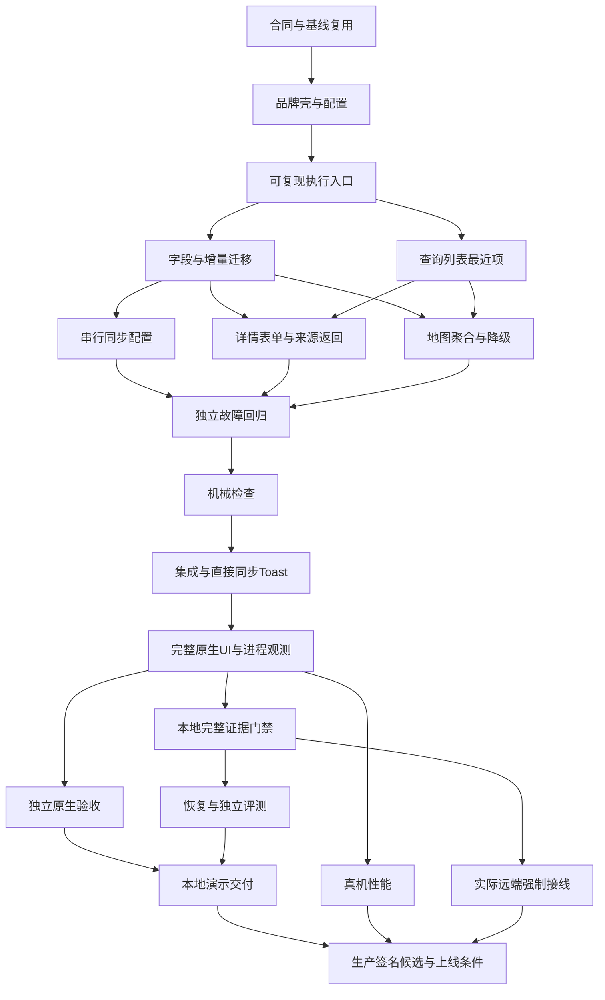

<!-- ocean-delivery-epic:FLUTTER-PARITY; contract:5 -->
# Ocean Delivery：完整原型 Flutter 功能与 Harness/Skill 工程闭环

类型：Epic · 需求：R01–R17 · 来源基线：`3e0300848fcded055abcc47448c06a165d0472d6` · 合同 revision=5。

将现有地图优先原型和架构交付为 Flutter demo/local-client。当前 main 只有 SQLite/outbox 与最小原生列表可靠性基线；本轮先发布和联动工作单，功能仍待按依赖实施。

## 范围与来源

- [原题/CSV](https://github.com/KuroGeo/transvirtual-driver-delivery/tree/3e0300848fcded055abcc47448c06a165d0472d6/docs/assignment)、[架构](https://github.com/KuroGeo/transvirtual-driver-delivery/blob/3e0300848fcded055abcc47448c06a165d0472d6/docs/solution-design.md)、[当前原型](https://github.com/KuroGeo/transvirtual-driver-delivery/blob/3e0300848fcded055abcc47448c06a165d0472d6/prototype/README.md)。
- 最新 [直接同步](https://github.com/KuroGeo/transvirtual-driver-delivery/blob/3e0300848fcded055abcc47448c06a165d0472d6/prototype/direct-sync-design.md) / [按入口返回](https://github.com/KuroGeo/transvirtual-driver-delivery/blob/3e0300848fcded055abcc47448c06a165d0472d6/prototype/origin-return-design.md) 优先历史同步抽屉。
- 地图聚合/搜索状态筛选/最近站点/列表详情/失败表单/直接同步Toast/离线保存和跨进程恢复，以及架构 Waiting only、视口恢复与底图降级。
- time_window 与预设失败原因/独立可选备注不得丢失；保存后保留终态详情，按 list/map/nearest 来源返回。
- 显式 demo 模拟确认；默认 local-client 无服务保留队列。应用内 online、OS 网络、底图和真实服务独立。
- 不新增登录、真实后端、路线/ETA、产品内 AI、照片/签名、持续后台定位/上传。签名生产/外部上线不因本 Epic 获得授权。

## 历史去重与基线复用

- 发布前查询 #1–#10：均已 CLOSED/not_planned，正文为旧 take-home/列表设计，不能以关闭状态认定 Flutter 已交付。保留历史，不重开旧范围。
- #3/#4/#5 的领域/SQLite/串行同步需求已有 PR #13 基线实现；E00 核验当前候选后复用，E02/E05 只补字段/升级/配置/超时等增量。
- #7/#8/#9/#10 的历史 UI/验证/交付范围由本轮新子项替代；网页78/78、窄三进程probe、debug构建分别只证明其实际层级。

## 子 Issue 与阻塞图

| 子项 | 可独立验收结果 | 前置依赖 | 主职能 |
| --- | --- | --- | --- |
| [E00 · #15](https://github.com/KuroGeo/transvirtual-driver-delivery/issues/15) | 冻结原型功能合同、共享接口与已有可靠性基线复用条件 | 无 | requirements-and-coordinator |
| [E01 · #16](https://github.com/KuroGeo/transvirtual-driver-delivery/issues/16) | 装配 Flutter 品牌应用壳、地图依赖和显式运行配置入口 | [E00 · #15](https://github.com/KuroGeo/transvirtual-driver-delivery/issues/15) | development-bootstrap |
| [X00 · #17](https://github.com/KuroGeo/transvirtual-driver-delivery/issues/17) | 扩展 Harness 的完整产品配置执行入口并复验隔离环境 | [E01 · #16](https://github.com/KuroGeo/transvirtual-driver-delivery/issues/16) | harness-engineering |
| [E02 · #18](https://github.com/KuroGeo/transvirtual-driver-delivery/issues/18) | 以增量迁移补齐时间窗、失败备注和持久会话设置 | [X00 · #17](https://github.com/KuroGeo/transvirtual-driver-delivery/issues/17) | development-data |
| [E03 · #19](https://github.com/KuroGeo/transvirtual-driver-delivery/issues/19) | 实现共享查询结果、最近站点和可恢复的配送列表 | [X00 · #17](https://github.com/KuroGeo/transvirtual-driver-delivery/issues/17) | development-query-list |
| [E05 · #20](https://github.com/KuroGeo/transvirtual-driver-delivery/issues/20) | 补齐 demo 连通性、串行同步与故障后的确定重试 | [E02 · #18](https://github.com/KuroGeo/transvirtual-driver-delivery/issues/18) | development-sync |
| [E11 · #21](https://github.com/KuroGeo/transvirtual-driver-delivery/issues/21) | 还原详情失败表单、保存后终态与按入口返回 | [E02 · #18](https://github.com/KuroGeo/transvirtual-driver-delivery/issues/18), [E03 · #19](https://github.com/KuroGeo/transvirtual-driver-delivery/issues/19) | development-detail |
| [E06 · #22](https://github.com/KuroGeo/transvirtual-driver-delivery/issues/22) | 交付地图聚合、站点状态联动及底图失败降级 | [E02 · #18](https://github.com/KuroGeo/transvirtual-driver-delivery/issues/18), [E03 · #19](https://github.com/KuroGeo/transvirtual-driver-delivery/issues/19) | development-map |
| [E04 · #23](https://github.com/KuroGeo/transvirtual-driver-delivery/issues/23) | 独立检验产品查询、迁移、同步和返回的故障闭环 | [E05 · #20](https://github.com/KuroGeo/transvirtual-driver-delivery/issues/20), [E11 · #21](https://github.com/KuroGeo/transvirtual-driver-delivery/issues/21), [E06 · #22](https://github.com/KuroGeo/transvirtual-driver-delivery/issues/22) | testing |
| [X01 · #24](https://github.com/KuroGeo/transvirtual-driver-delivery/issues/24) | 把需求、Issue、测试及架构边界纳入机械检查 | [E04 · #23](https://github.com/KuroGeo/transvirtual-driver-delivery/issues/23) | harness-engineering |
| [E07 · #25](https://github.com/KuroGeo/transvirtual-driver-delivery/issues/25) | 集成地图工作台与直接同步 Toast，保持当前任务上下文 | [E01 · #16](https://github.com/KuroGeo/transvirtual-driver-delivery/issues/16), [E05 · #20](https://github.com/KuroGeo/transvirtual-driver-delivery/issues/20), [E06 · #22](https://github.com/KuroGeo/transvirtual-driver-delivery/issues/22), [E11 · #21](https://github.com/KuroGeo/transvirtual-driver-delivery/issues/21), [X01 · #24](https://github.com/KuroGeo/transvirtual-driver-delivery/issues/24) | coordinator-integration |
| [X02 · #26](https://github.com/KuroGeo/transvirtual-driver-delivery/issues/26) | 提供完整产品的后台原生 UI 驱动、进程恢复和业务观测 | [E07 · #25](https://github.com/KuroGeo/transvirtual-driver-delivery/issues/25) | harness-engineering |
| [E08 · #27](https://github.com/KuroGeo/transvirtual-driver-delivery/issues/27) | 独立验收完整原生功能与离线多结果跨进程恢复 | [X02 · #26](https://github.com/KuroGeo/transvirtual-driver-delivery/issues/26) | native-acceptance |
| [X03 · #28](https://github.com/KuroGeo/transvirtual-driver-delivery/issues/28) | 让本地门禁严格校验完整需求、性能和资源的候选证据 | [X02 · #26](https://github.com/KuroGeo/transvirtual-driver-delivery/issues/26), [X01 · #24](https://github.com/KuroGeo/transvirtual-driver-delivery/issues/24) | harness-engineering |
| [X04 · #29](https://github.com/KuroGeo/transvirtual-driver-delivery/issues/29) | 验证完整产品工具的中断恢复、资源重入和独立 Agent 评测 | [X02 · #26](https://github.com/KuroGeo/transvirtual-driver-delivery/issues/26), [X03 · #28](https://github.com/KuroGeo/transvirtual-driver-delivery/issues/28) | harness-engineering |
| [E10 · #30](https://github.com/KuroGeo/transvirtual-driver-delivery/issues/30) | 交付可复现的完整 Flutter 演示与本地客户端证据包 | [E08 · #27](https://github.com/KuroGeo/transvirtual-driver-delivery/issues/27), [X04 · #29](https://github.com/KuroGeo/transvirtual-driver-delivery/issues/29) | release-handoff |
| [E09 · #31](https://github.com/KuroGeo/transvirtual-driver-delivery/issues/31) | 在约定真机与工作负载下验证启动、帧时间和内存预算 | [X02 · #26](https://github.com/KuroGeo/transvirtual-driver-delivery/issues/26) | performance |
| [X05 · #32](https://github.com/KuroGeo/transvirtual-driver-delivery/issues/32) | 落实实际 required checks 与不可绕过的发布门禁路径 | [X03 · #28](https://github.com/KuroGeo/transvirtual-driver-delivery/issues/28) | harness-engineering |
| [E12 · #33](https://github.com/KuroGeo/transvirtual-driver-delivery/issues/33) | 满足 Harness 与产品生产门槛后准备签名发布候选 | [E10 · #30](https://github.com/KuroGeo/transvirtual-driver-delivery/issues/30), [E09 · #31](https://github.com/KuroGeo/transvirtual-driver-delivery/issues/31), [X05 · #32](https://github.com/KuroGeo/transvirtual-driver-delivery/issues/32) | release-handoff |

图简化传递依赖；上表/仓库 backlog.json 为完整硬依赖。GitHub sub-issue 表示父子，blocked-by 表示依赖，两者分别建立并回读核验。

## Skill 与 Harness 的接力

[团队主控](https://github.com/KuroGeo/transvirtual-driver-delivery/blob/3e0300848fcded055abcc47448c06a165d0472d6/.agents/skills/agent-engineering-team/SKILL.md) 调用 [需求提取](https://github.com/KuroGeo/transvirtual-driver-delivery/blob/3e0300848fcded055abcc47448c06a165d0472d6/.agents/skills/engineering-requirements-extract/SKILL.md) → 每个子项由 [Issue authoring](https://github.com/KuroGeo/transvirtual-driver-delivery/blob/3e0300848fcded055abcc47448c06a165d0472d6/.agents/skills/engineering-issue-authoring/SKILL.md) 写行为合同/去重 → 对应 Flutter/Harness 开发 → 独立测试 → 原生验收/性能 → 交付。

每条子项都给出实际 Skill 链接、输入/消费者、单一写域、Harness 命令、证据层级与关闭条件。主控唯一维护 mission/contracts/backlog/work，实际派工记录 owner/base/fingerprint/contract/result/lease；依赖 accepted 才 ready，开发返回先 review，独立审查后 accepted。

Harness 用同一 `check/quality/test/build/native/gate` 入口；新增完整 UI/trace 支持先由 X00/X02 落地。当前 `native` 仅 probe、`test --target` 仅 app/test，不把未来命令写成已支持。默认后台，不激活用户窗口/标签，确需前台按项目规则单独取得授权。

## 完成条件与关闭顺序

- [ ] E00–E08/E11 与 X00–X04 在当前候选满足功能/质量/独立原生/恢复要求，E10交付可复现 demo/local-client 证据包。
- [ ] E09 真机预算、X05 实际强制路径、许可/签名/授权条件满足后，E12 才可按实际生产范围验收；缺项保持 blocked/no-go。
- [ ] 只有各子项的原始候选证据核验后关闭对应工程任务；PR合并/Issue发布/测试数量不代签产品完成。

本 Epic 跟踪完整产品路线，E10 本地演示可先完成；生产责任保留在 E12，父项不凭本地交付直接关闭。当前生产 no-go。

下一执行项为 E00，合同/写域冻结后 E01→X00，再并行 E02 数据与 E03 查询。未预填人员账号、排期或通过状态。
