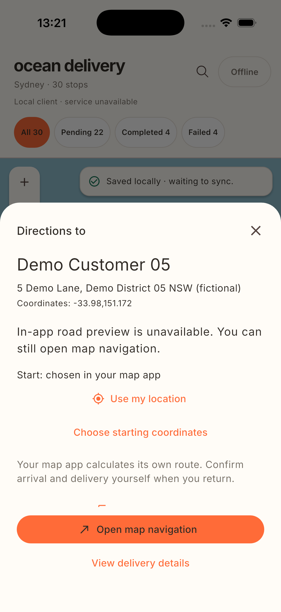

# F1 coordinate navigation repair — 2026-10-12

The current candidate `2da2eac55f40d8b65e8a167b6db433d547d519f6250acf0210412f031904cff1` (source commit `48252a39e0ed7c6cdd504f3153740003e2636c19`) passes isolated quality: **252 Python cases (one existing platform skip),265 Flutter successes**, format/analysis/locked dependencies and all11 F1 host checks. Fresh native-fixture `20261012T051942704734Z-native` passed7checks/3OSprocesses **4205/4371/4449**, original SQLite/outbox invariance and task cleanup. CLI `20261012T052248642223Z-f1-gate` reread all originals and allowed `native-fixture`, with `publish_allowed=false`. Independent original host/native review also passed; the separate actual Apple pin/OS-return review also passed. [Exact current hashes and receipts](f1-navigation.json).

## Repaired behavior

With an unknown start and disabled location services, Apple directions previously opened its start picker over an unrelated old map. Apple Maps now opens the **stored destination coordinate pin** first; the driver chooses Directions and a start there. With a reliable start it retains driving directions with both coordinates. The preview shows the destination coordinates and acknowledges only a map-opening request. No stop/CSV/SQLite/schema data was changed.

Actual formal `lib/main.dart`/demo installation on the existing Ocean Delivery Preview preserved the original30stops and one queued update. Native UI taps on the reported original stop opened its exact stored coordinate pin in the correct Sydney area, even with location services off; actual OS return retained the same pending delivery detail. Installed Runner/kernel bytes match the current compiled artifact; before/after original dataset/stop/outbox/sequence rows agree. Raw UI PNGs and SQLite snapshots are retained under `harness/runs/20261012T052303209406Z-build/attempts/000001/preview/`. This is **Apple coordinate-pin and return evidence on an iOS simulator**, not real GPS or driving from the user's location. The supplied fictional address text differs from Maps' reverse-geocoded street; we preserve the station data.

## Original30name audit

The current finite original dataset was checked row by row using name plus supplied address/suburb. **0verified name-and-target-location matches;15ambiguous/other-location or similar-name cases;15unverified cases. All30retain their coordinates.** Missing public matches do not prove nonexistence. Same-name businesses elsewhere are rejected. The private full30query/source/date audit is retained at `harness/runs/f1-original-stop-verification-20261012/all30.public-verification.md`; its JSON hash is in the current receipt. No original assignment/customer data was added to this public PR.

The screenshot below is an unmodified **private fixture** capture from the current candidate, independent of the original customer-data preview. It does not attest licensed road data.

The previous candidate's original evidence and red/repair history remain below. Current exact original files are listed in the JSON receipt. F2/F3 remain preparation; licensed supplier, real GPS/driving origin, Google/Android/physical-device and release gates remain unverified. Production is **no-go**; PR review and current-head CI are separate.

---

# Historical F1 navigation candidate and evidence — 2026-10-12

F1 client navigation is implemented and the current local **quality, host and native-fixture gates passed**. Independent review of the exact originals also passed. Production remains **no-go**. F2/F3 retain their approved preparation records; no login, account storage, own route backend or AI executor is implemented by this candidate.

Source code freeze: `453582ac7b196ad5ddbf05a70143111060d23b78`. Candidate source fingerprint: `d651e5c96ec8410cdebd97368c10bc2caabb43a91016919a9d23874a8df985cb`. Main: `53c2089349aacf90a330a9245dbd14789eb16d2e`; approved planning: `5f32b66a91dbd6b92b692d252188e23e3e64276e`. Later commits containing excluded reports/board entries do not alter this source candidate. [Execution contract](../project/next-phase/f1-execution.md) · [Client handoff](../../docs/next-phase/f1-client-handoff.md) · [Machine-readable receipts](f1-navigation.json).

## Resulting driver flow

From an existing list/query, map or nearest-stop detail, **Navigate** opens destination preview. Drivers can explicitly request one foreground location fix, confirm starting coordinates, select Apple/Google Maps or browser directions, copy the address and return through the original detail to its source. The retained delivery view model, query/list context and map are preserved in-process. Successful platform launch is an acknowledgement, never arrival or delivery completion. Navigation exposes no delivery/outbox write port. Session, dataset, target, origin revision and attempt changes revoke pending results and launches.

The formal default road adapter is unavailable because no licensed client road supplier is configured. No in-app road line or ETA is invented. The supplier boundary accepts coordinates/departure/driving mode only; local account/stop/request/operation identifiers and notes never enter it. Road response provenance, timestamps, arrival, geometry and configuration are validated; expired results clear. Actual supplier integration remains an external dependency.

## Exact local verification

| Layer | Current result | Scope |
| --- | --- | --- |
| Isolated full quality | passed | Seven stages; 252 Python cases with one existing platform skip; 263 non-skipped Flutter successes; locked dependencies, format and analysis; before/after fingerprints equal; task copy/process groups/leases cleaned |
| F1 host gate | passed | All 11 exact frozen suite/name checks verified against original machine events; includes 15 independently authored controller/widget tests |
| Native iOS fixture | passed | Private entry, iPhone 17 Pro / iOS 26.4, debug/local-client; three genuine OS PID/session launches, native SQLite backups, 116 inventoried raw artifacts and seven F1 UI checks |
| F1 native feature gate | passed | Re-read current quality, original source/input/compiled archive, UI journals/snapshots, SQLite and cleanup; `level=native-fixture`, `feature_allowed=true`, `publish_allowed=false` |
| Independent native review | passed | All 116 original artifacts and seven UI claims reread; stale candidate, wrong level and tampered collector hash copies rejected; originals preserved; see [NP11/NP12 report](../project/next-phase/results/NP11-NP12-F1.md) |
| Remote PR / CI | reported separately on the PR | CI independently regenerates host evidence for its actual head; local native results do not attest remote CI or merge |

Saved phase PID **83741** exercised list/query and preview; recovered PID **83923** exercised cold recovery plus map/nearest source returns; confirmed PID **83999** read-only reopened the recovered state. Each phase retained two distinguishable manually created offline operations. All post-baseline observations and the three SQLite projections preserved dataset, delivery and outbox state; confirmed preserved **all** recovered tables, including the viewport/online setting. Each process terminated and the task-owned simulator was deleted. Controlled Apple availability failure and Google launch failure precede explicit browser handoff. These are fixture receipts, not real external Maps launches.

Independent host regressions found and verified repairs for removed-target empty detail, accepted GPS failing to revoke an origin-less pending launch, and maximum-font keyboard dialog overflow. The 53/17 text scale uses the real font; portrait and rotated landscape keyboard insets are host fixtures. A pre-existing direct maximum-font landscape overview entry remains a separately recorded limitation.

## Original evidence

Raw files below are original local files under ignored `harness/runs/`. They remain on the attached worktree and are not checked into the PR. The report and screenshot review copies do not replace gate inputs; CI regenerates host proof.

| Original evidence | Worktree-relative path | SHA-256 |
| --- | --- | --- |
| Quality attempt | `harness/runs/20261011T201840828764Z-quality/attempts/000001/report.json` | `4e5c2d42996093d10c39158b7dc174099eb9b8b8fdd547cf0ba3b5d944a6dcbc` |
| Flutter machine events | `harness/runs/20261011T201840828764Z-quality/attempts/000001/flutter-tests.events.jsonl` | `9e615b2b57b88a9b068bb143f6601a8d43bab7c0848cbc2a98e91b54c6ad2814` |
| Approved Git object proof | `harness/runs/20261011T201840828764Z-quality/attempts/000001/source-objects.json` | `13f6c9cf86b34e088e9a0ce6cf9a7e27ae432c7bc9b7502741459381b750ea2c` |
| Host manifest | `harness/runs/20261011T201840828764Z-quality/attempts/000001/f1-host/manifest.json` | `dc0bc2f466721c69e8dd891d09d6ef4e6e4ceb3476ff25007cd7f9f1622f07d1` |
| Host gate | `harness/runs/20261011T201840828764Z-quality/attempts/000001/f1-host/gate.json` | `3daa541e226288f8ab1cac5f08637671b28f3ad6753558b680bc69f97d42f265` |
| Native runner | `harness/runs/20261011T201944866727Z-native/attempts/000001/report.json` | `4efc897c996c0db700bde3205da618f4262812ede81d639b51f020c7cdf24ef0` |
| Native collector | `harness/runs/20261011T201944866727Z-native/attempts/000001/native/result.json` | `edbfb34b685a65a0fbad200b752ee6ba419dece48fb9b6e67997af9b3b12f386` |
| Compiled manifest | `harness/runs/20261011T201944866727Z-native/attempts/000001/artifact-workbench-build/manifest.json` | `25c087ed767bf821db7cb9408ac252aa52346c66dacca3bb21cac46fab796c82` |
| Compiled archive | `harness/runs/20261011T201944866727Z-native/attempts/000001/artifact-workbench-build/Runner.tar.gz` | `b6f2d1bfe1809ddcf02bc06743941c7ba61f0627cfa796d9885d7c83553e3433` |
| Native manifest | `harness/runs/20261011T201944866727Z-native/attempts/000001/f1-evidence/manifest.json` | `130b8028a504f01a2d5188a590084a75609757830690140caebcfa1d80b0ac5d` |
| F1 native gate attempt | `harness/runs/20261011T202147031748Z-f1-gate/attempts/000001/report.json` | `f9a24edadcac658ec6342e5f046a35fcc1637468558b98b84cae51dc11c8c4fd` |
| F1 native gate JSON log | `harness/runs/20261011T202147031748Z-f1-gate/attempts/000001/f1-evidence-gate.log` | `72d21cdafb0bef46aa81a2530769565a05bc1a5eb81ecfc8e57419b03b284a10` |

The JSON receipt also records each phase's result, SQLite projection/database, action/observation journal and OS screenshot hashes. [Harness result](../project/next-phase/results/NP01-F1.md) · [Routes result](../project/next-phase/results/NP05-NP06-F1.md).

## Historical review screenshot

The previous candidate's unmodified OS PNG remains at `harness/runs/20261011T201944866727Z-native/attempts/000001/native/saved/list-navigation-preview.png`, SHA-256 `bf4902715254d752fdcb41532c45cc7b2c0e574a541bc1820c066aeeb1457b61`. The public display copy above now shows the current candidate. Both use controlled gateways and fictional fixture data; neither attests GPS or licensed roads.

## Retained failures and repairs

Original failed attempts were retained, never rewritten as passes. `193503269376Z-test` found missing-target return; `194139299600Z-test` found late GPS fencing and keyboard overflow. `195125282870Z-quality` failed before Flutter because isolated sources lacked historical Git objects; approved commit/tree/blob proof now survives isolated cleanup. `200243274758Z-native` failed after the saved phase with ENOSPC; verified archive retention and task-only disposable build pruning lowered storage without touching user caches. `201358961156Z-native` reached three processes but nearest-stop selection persisted a viewport in the strictly read-only confirmed phase; original delivery/outbox state was unchanged. The driver moved that interaction to recovery, leaving confirmed read-only and **all existing collector comparisons unchanged**. The current full quality/native runs above followed the final repair.

## Remaining acceptance boundaries

| Boundary | Status |
| --- | --- |
| Real external Apple/Google Maps and OS return | not_run; private gateway is `controlled-navigation-fixture` |
| Real GPS / permission UI | not_run; private location fixture denies permission |
| Real licensed roads / ETA / cache terms | blocked; supplier configuration absent |
| Physical iOS/Android device; Android native build/flow | not_run |
| OS keyboard/hardware back; signed release | not_run |
| Process death navigation context | no old navigation session restoration; cold launch restores workbench/durable deliveries/outbox |
| F2 login / account migration; F3 AI | planned only |
| Production | no-go; #31/#32/#33 and release authorization remain separate |

The portable execution board stays `review` for local implementation slices and `blocked` for NP13. It grants no product or publication acceptance. Exact local gate outcomes live in this excluded receipt; historical preparation/publication records are unchanged. No merge or release was performed.

Independent review receipt: `harness/runs/f1-independent-review-20261011T202402299085Z/review-receipt.json`, SHA-256 `2a48c217ddab8f77a03a41a6165470c801b2b8a24aca6b0ae8b7b84bb39e8c67`. Reviewer `/root/f1_acceptance` signed the current local host/native-fixture scope only.
